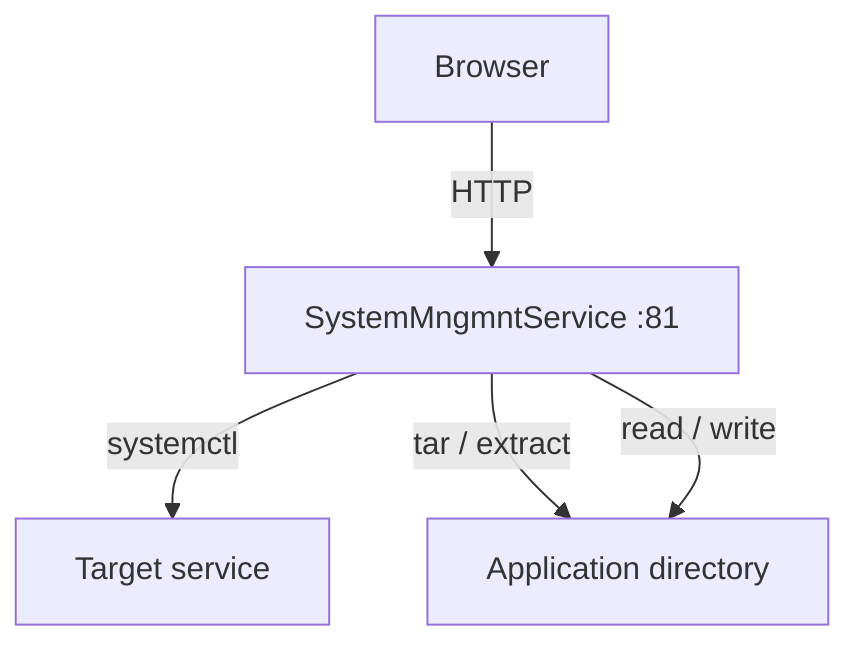
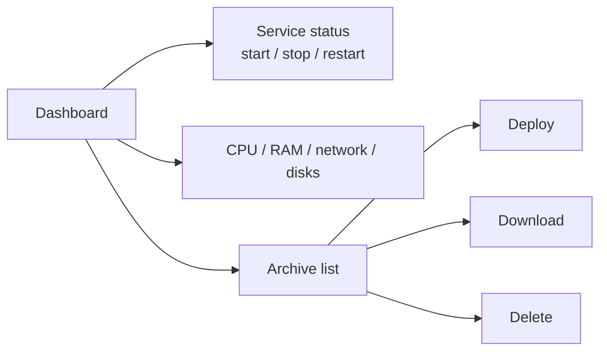
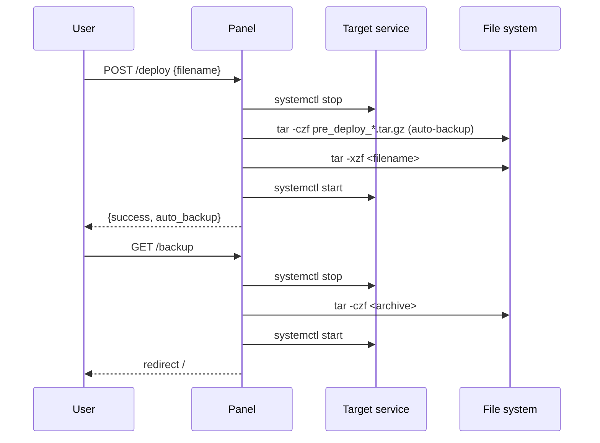
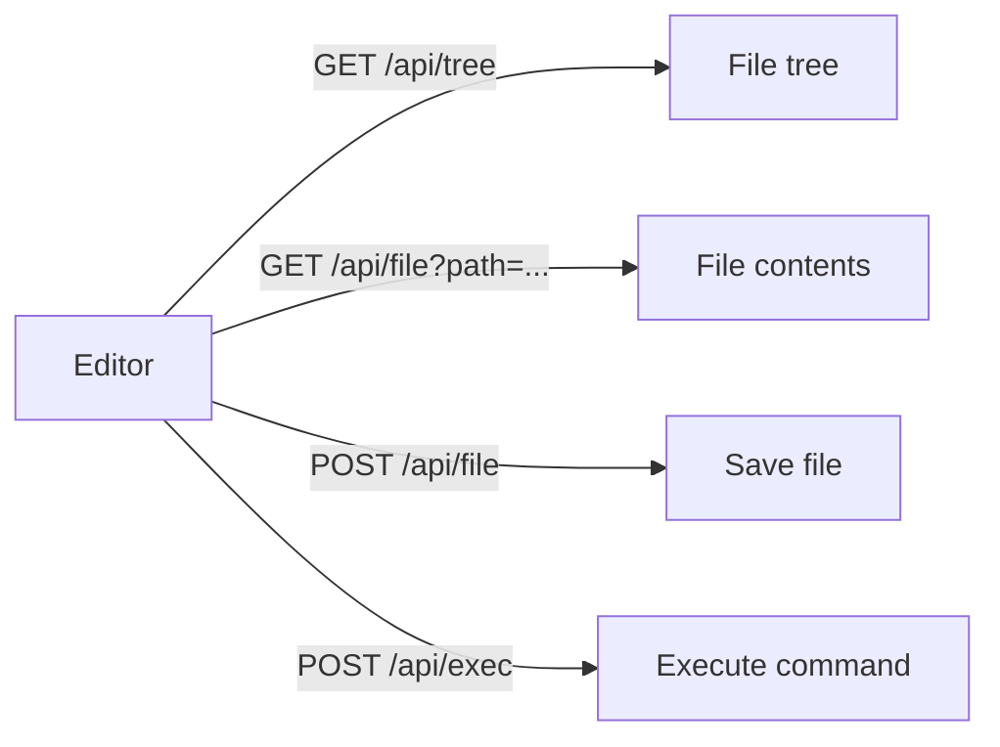

# SystemMngmntService

A web panel for remote monitoring and management of an application on a Linux server.  
Runs as a standalone systemd service, independent of the target application's state.

---

## Purpose

- Monitor and control a target systemd service (start / stop / restart)
- Create backups of the application directory, upload and deploy updates
- Edit application files directly in the browser
- View system information (CPU, RAM, network, disks)
- Configure all parameters through the web interface

---

## Project Structure

```
SystemMngmntService/
├── app.py          # Flask application — all routes and logic
├── config.json     # Configuration (paths, port, service, authentication)
├── main.py         # Entry point (reserved)
├── setup.sh        # Installation and systemd registration script
└── templates/
    ├── index.html    # Main dashboard
    ├── editor.html   # Code editor
    └── settings.html # Settings page
```

---

## Configuration (`config.json`)

| Field | Description |
|---|---|
| `target_dir` | Target application directory |
| `backup_dir` | Directory for archive storage |
| `archive_name` | Default archive filename |
| `service_name` | Name of the systemd service to monitor |
| `host` / `port` | Panel listen address |
| `auth.enabled` | Enable / disable login |
| `auth.username` / `auth.password` | Credentials |

---

## Main Flow



---

## Routes

### Dashboard (`/`)



### Backup and Deploy



### Code Editor (`/editor`)



---

## API

| Method | Route | Description |
|---|---|---|
| GET | `/api/status` | `systemctl status` output |
| GET | `/api/sysinfo` | CPU, RAM, network, disks (JSON) |
| GET | `/api/backups` | Archive list (JSON) |
| POST | `/deploy` | Deploy archive (with auto-backup) |
| POST | `/delete_backup` | Delete archive |
| GET | `/api/tree` | File tree of the target directory |
| GET/POST | `/api/file` | Read / write file |
| POST | `/api/exec` | Execute shell command (editor auth required) |
| GET | `/api/service/<action>` | start / stop / restart via API |
| GET | `/api/browse` | Browse the file system |

---

## Installation

```bash
sudo bash setup.sh
```

The script performs:
1. `apt install python3-flask` and `apt-get install p7zip-full`
2. `setcap cap_net_bind_service=+ep` on Python3 (required for ports < 1024)
3. Creates and starts `/etc/systemd/system/systemmngmntservice.service`

### Service management

```bash
sudo systemctl status systemmngmntservice.service
sudo systemctl restart systemmngmntservice.service
journalctl -u systemmngmntservice.service -f
```

---

## Authentication

When `auth.enabled = true`, all routes and API endpoints require an active session.  
The code editor and `/api/exec` have a separate `editor_authed` check.  
Credentials are stored in `config.json` and can be changed via `/settings`.

