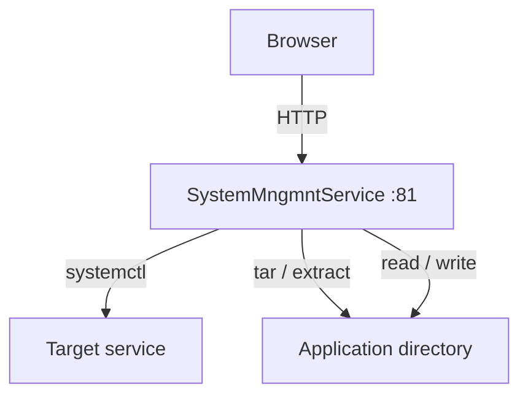
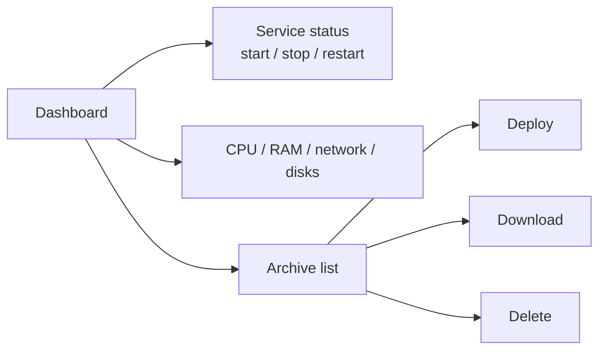
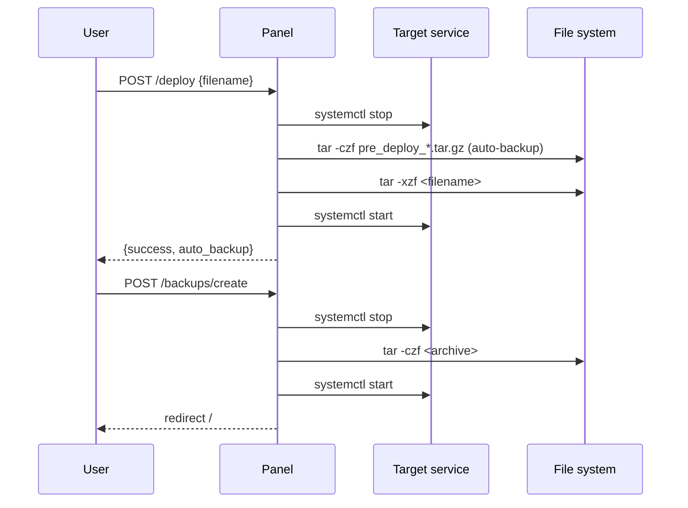
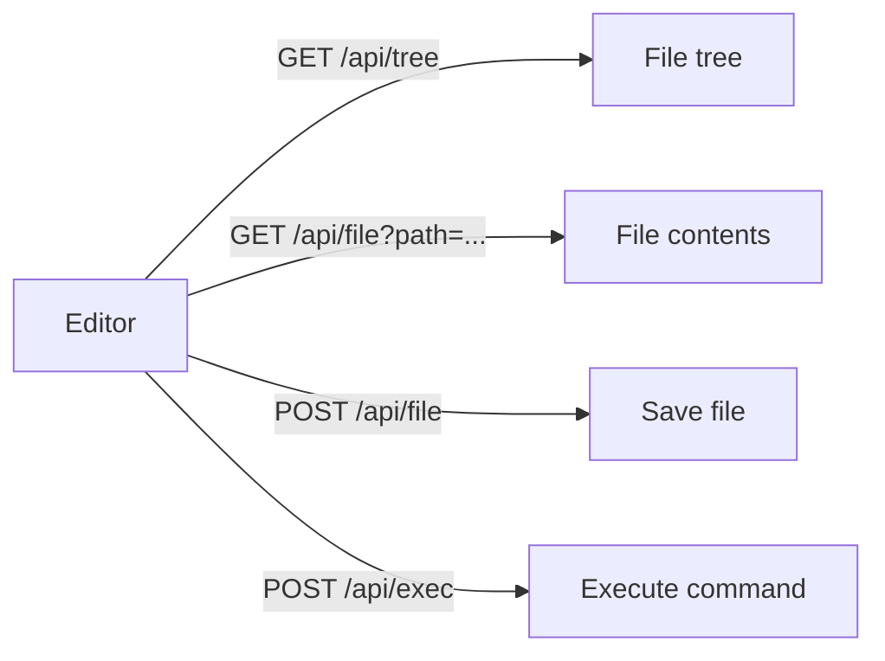

# SystemMngmntService

A web panel for remote monitoring and management of an application on a Linux server.  
Runs as a standalone systemd service, independent of the target application's state.

---

## Purpose

- Monitor and control a target systemd service (start / stop / restart)
- Create backups of the application directory, upload and deploy updates
- Edit application files directly in the browser
- Run test-platform sequences, watch PASS/FAIL live, keep a log per run
- View system information (CPU, RAM, network, disks)
- Configure all parameters through the web interface

---

## Project Structure

```
SystemMngmntService/
├── app.py            # Entry point: creates the Flask app and registers blueprints
├── config.json       # Configuration (paths, port, service, authentication)
├── macros.json       # Code editor command macros
├── core/             # Shared backend: config, auth, shell helpers, navigation, template context
├── routes/           # One Flask blueprint per feature (dashboard, services, backups, editor, ...)
├── templates/
│   ├── base.html     # Common layout: top bar, shared modals and scripts
│   ├── partials/     # Reusable fragments (services modal, video, power menu, flash)
│   ├── index.html    # Main dashboard
│   ├── editor.html   # Code editor
│   ├── settings.html # Settings page
│   └── login.html    # Login page
├── static/
│   ├── css/          # base.css + components.css (shared), <page>.css
│   ├── js/           # core.js, services.js, sysinfo.js, video.js, power.js, devices*.js (shared), <page>.js
│   └── img/
├── testPlatform/     # Test platform: *_test.py sequences + hardware drivers (run from the Tests page)
├── testLogs/         # One log file per test run (git-ignored)
├── CLAUDE.md         # Development rules (for humans and AI assistants)
└── setup.sh          # Installation and systemd registration script
```

See `CLAUDE.md` for how to add pages and API endpoints.

---

## Configuration (`config.json`)

One config file serves every machine the project is deployed to:

```json
{
    "default": { "target_dir": "...", "service_name": "...", "auth": { ... } },
    "hosts": {
        "orangepi3b": { "device_name": "NAS", "target_dir": "...", ... }
    }
}
```

- The machine is identified by its hostname.
- A host without its own section uses `default` (missing keys fall back to built-in defaults).
- Saving on the Settings page stores the settings in the section of the current host; from then on that host
  uses its own values. "Reset to defaults" on the Settings page removes the section.
- An old flat `config.json` is converted automatically on first start.

Fields (same in `default` and in a host section):

| Field | Description |
|---|---|
| `target_dir` | Target application directory |
| `backup_dir` | Directory for archive storage |
| `archive_name` | Default archive filename |
| `service_name` | Name of the systemd service to monitor |
| `host` / `port` | Panel listen address |
| `auth.enabled` | Enable / disable login |
| `auth.username` / `auth.password` | Credentials |
| `public_service_actions` | Service actions allowed without login (default `["restart"]`) |

---

## Main Flow



---

## Routes

### Dashboard (`/`)



### Backup and Deploy



### Code Editor (`/editor`)



---

## API

| Method | Route | Access | Description |
|---|---|---|---|
| GET | `/api/services` | public | All systemd services (JSON) |
| GET | `/api/status?name=` | public | `systemctl status` output |
| POST | `/api/service/<start\|stop\|restart>?name=` | public for `public_service_actions`, else login | Service action |
| GET | `/api/sysinfo` | login | CPU, RAM, network, disks (JSON) |
| POST | `/api/power/<reboot\|poweroff>` | login | Reboot / shut down |
| GET | `/api/backups` | login | Archive list (JSON) |
| POST | `/backups/create` | login | Create archive (form) |
| POST | `/backups/upload` | login | Upload archive (multipart form) |
| GET | `/backups/download/<name>` | login | Download archive |
| POST | `/api/backups/deploy` | login | Deploy archive (with auto-backup) |
| POST | `/api/backups/delete` | login | Delete archive |
| GET | `/api/tree` | login | File tree of the target directory |
| GET/POST | `/api/file` | login | Read / write file |
| POST | `/api/file_create`, `/api/file_rename`, `/api/file_delete` | login | File operations |
| GET | `/api/file_raw` | login | Raw file (image preview) |
| POST | `/api/exec` | login | Execute shell command |
| GET/POST | `/api/macros` | login | Editor command macros |
| GET | `/api/video_devices`, `/api/video_resolutions`, `/api/video_feed` | login | Video streaming |
| POST | `/api/video_stop` | login | Stop video stream |
| GET | `/api/browse` | login | Browse directories (settings path picker) |
| GET | `/api/devices/dev` | login | `/dev` tree (type, maj:min, mode, owner, symlink target) |
| GET | `/api/devices/dev/info?path=\|devpath=` | login | `udevadm info` properties of a node in `/dev` or a `/devices/...` path |
| GET | `/api/devices/list` | login | Device nodes from the udev database, grouped by kind |
| GET | `/api/devices/buses` | login | USB topology, PCI devices, I²C adapters and clients |
| GET | `/api/devices/usb/verbose[?bus=&dev=]` | login | `lsusb -v -s bus:dev`, or `lsusb` + `lsusb -t` |
| GET | `/api/devices/gpio` | login | GPIO chips and lines like `gpioinfo` (read-only, libgpiod v1/v2) |
| GET | `/api/devices/gpio/ctl?client=` | login | Lines held by a popup client with live values (also renews its lease) |
| POST | `/api/devices/gpio/ctl` | login | `{client, action: claim\|input\|output\|set\|release\|release_all, chip, offset, value}` |
| GET | `/api/net/interfaces` | login | Interfaces (state, addresses, counters, CAN bit timing), routes, DNS |
| POST | `/api/net/can/link` | login | `{iface, action: open\|close, bitrate, sample_point, restart_ms, listen_only}` |
| GET | `/api/net/can/frames?iface=&since=` | login | New CAN frames + cyclic jobs; polling keeps the socket open |
| POST | `/api/net/can/send` | login | `{iface, action: send\|cyclic\|stop\|stop_all\|clear, id, ext, rtr, data, period_ms, job}` |
| GET | `/api/udev/status` | login | systemd-udevd state, udev version, rules counts, subsystems |
| POST | `/api/udev/action` | login | `{action: reload\|restart\|trigger\|test\|attrs, kind, subsystem, device, devpath, all}` |
| GET | `/api/udev/events?since=` | login | New monitor events; polling keeps `udevadm monitor` running |
| POST | `/api/udev/events/clear` | login | Clear the event buffer |
| GET | `/api/udev/rules` | login | Rules files of `/etc`, `/run`, `/lib` with override info |
| GET | `/api/udev/rule?dir=&name=` | login | Read one rules file |
| POST | `/api/udev/rule` | login | Save `{name, text, force}` to `/etc/udev/rules.d` (422 on syntax problems unless `force`) |
| POST | `/api/udev/rule/check` | login | Syntax check `{text}` → `{problems: [{line, message}]}` |
| POST | `/api/udev/rule/delete` | login | Delete `{name}` from `/etc/udev/rules.d` |
| POST | `/api/settings` | login | Save settings |
| GET | `/api/tests/scripts` | login | Test scripts (`*_test.py` in `tests_dir`) |
| POST | `/api/tests/start` / `/api/tests/stop` | login | Start `{script, serial, stop_on_fail}` / stop the running one |
| GET | `/api/tests/status?run_id=&results_from=&output_from=` | login | Current run, incremental results, output and pending operator prompt |
| POST | `/api/tests/answer` | login | Answer the pending operator prompt `{run_id, prompt_id, value}` |
| GET | `/api/tests/logs`, `/api/tests/logs/<name>[?download=1]` | login | Run history / log file |
| POST | `/api/tests/logs/delete` | login | Delete `{name}` or `{all: true}` |
| GET | `/api/tests/stats?script=` | login | Board counts per verdict for a script |

---

## Devices popup

The **Devices** button in the top bar (logged in) opens a popup with six tabs. With *Auto* on, the
current view refreshes every 2–3 s; new devices are highlighted, added/removed ones are listed in the
footer (plus a toast, except `/dev/pts`, `/dev/shm`). All groups, trees, chips, bus sections and rules
directories start collapsed (a filter expands what matches; *Expand* / *Collapse* buttons). Clicking a device opens a side panel with its udev
properties and actions: *Attributes* (`udevadm info -a`), *Test rules* (`udevadm test`, dry run),
*Trigger change*, *New rule…* (drafts a rule matching the device and opens it in the rules editor).

- **Devices** — the udev database grouped by kind: serial ports, USB, video, I²C, SPI, GPIO, storage,
  input, sound, network, display, other, virtual (hidden by default). Human names (hwdb vendor/model,
  V4L product, disk model/size/filesystem), driver, VID:PID, symlinks.
- **/dev** — the device node tree (symlinks are not followed) with a group and a text filter.
- **Buses** — USB topology like `lsusb -t` (VID:PID, hwdb names, serial, speed, interface class → driver,
  device nodes of each device; 🔍 = `lsusb -v`), PCI (`lspci -k`), I²C adapters with the clients the kernel
  knows about (the bus is never scanned).
- **Network**
  - *Interfaces* — every interface with type, state, IPv4/IPv6, MAC, RX/TX rate and errors; a row expands to
    MTU, driver, link speed, packet counters (and bit timing / bus state / error counters for CAN).
    *Routes & DNS* below. Read-only: interfaces other than CAN are never reconfigured.
  - *CAN bus* — SocketCAN tool for `can*` / `vcan*`: *Open* applies bitrate, sample point, restart-ms,
    listen-only (`ip link set … type can …`, root) and brings the link up, *Close* brings it down (vcan: up/down
    only). Frames (RX, own TX, error frames with decoded class) in *Trace* or *By ID* (count, period, changed
    bytes highlighted). Send a frame (hex ID, Ext, RTR, hex data) or *Start repeat* every N ms; running
    repeats are listed with counters and a Stop button. The socket and all repeats exist only while the
    CAN view is open (leaving it stops the repeats, an idle client loses them after 10 s). Configuration is
    locked while a test script runs; starting a test stops all repeats.
- **GPIO** — every `/dev/gpiochip*` with its lines: offset, global sysfs number (`base + offset`), name,
  consumer, direction, active level, bias/drive flags. Without the Python `gpiod` module the raw
  `gpioinfo` output is shown.
  *Claim* requests a free line "as is" (its state is not changed), then it can be switched IN/OUT, an output
  toggled 0/1, an input level is read every second. Lines are held only while the GPIO tab is open:
  switching the tab, closing the popup or the page releases them, and a client that stops polling loses
  them after 6 s (`core/gpio_ctl.py`, `LEASE_SECONDS`). Claiming is refused while a test script runs, and
  starting a test releases every web-held line.
- **udev**
  - *Events* — live `udevadm monitor --kernel --udev --property` (filter by source, text; pause; click an
    event for its properties). The monitor process runs only while this view is polled and stops 10 s
    later (`core/udev.py`, `UdevMonitor`).
  - *Rules* — rules files of `/etc/udev/rules.d` (editable), `/run/udev/rules.d` and `/lib/udev/rules.d`
    (read-only, *Override in /etc* copies one into `/etc`). Overridden files are marked. *Check* runs a
    built-in syntax check (`udevadm verify` needs systemd ≥ 254); Save asks before writing a file with
    problems. Changes apply after *Reload rules*.
  - *Service & tools* — `systemd-udevd` status, restart, reload rules, `udevadm trigger` (by subsystem
    and/or device), `udevadm test`, attribute walk.

## Test Platform (`/tests`)

- Scripts: every `*_test.py` in `tests_dir` (default `testPlatform/`); the first line of the module docstring is
  shown as the description. Demo scripts (`demo_*_test.py`) need no hardware.
- A script runs as a child process (`python3 -u`, cwd = `tests_dir`, env `TEST_RUNNER=1`). Only one run at a time.
  Stdin receives one Enter and is closed, so interactive scripts run exactly one sequence.
- `testStrategy.TestStrategy` prints `@@RESULT {"name","condition","units","status"}` lines in runner mode;
  all other output is shown in the *Output* panel and written to the log.
- Verdict: `STOPPED` (Stop pressed: SIGINT, SIGKILL after 3 s), `ERROR` (any ERROR result, non-zero exit code,
  or no results), `FAIL` (any FAIL), otherwise `PASS`.
- Stop on fail + finalization: structure a script as `ts.run(steps, finalize)`. With the *Stop on fail* checkbox
  (checked by default; env `TEST_STOP_ON_FAIL=1`, or `--stop-on-fail` in a terminal) the first FAIL/ERROR skips the
  remaining steps. `finalize` (power off, relays to a safe state) always runs: after pass, fail, an exception or
  Stop (SIGINT; the runner waits 10 s before SIGKILL). Scripts without `ts.run()` are not affected.
  Separator rows (`ts.section(title)`) are shown in the results. Demo: `demo_stopfail_test.py`.
- Serial number: the *Serial number* field is passed to the script as `--sn <serial>` (letters, digits, `-_.`,
  up to 64 chars; empty = no argument). In a script: `ts.serial`. Enter in the field starts the test (barcode
  scanners); after a run the field is selected for the next unit. Demo: `demo_serial_test.py` (valid: `test`
  or `VTP-123456`).
- Logs: `test_logs_dir/<YYYYmmdd_HHMMSS>_<script>[__<serial>]_<VERDICT>.log` (`.running` while in progress).
  The *History* popup lists them (with serial) and can delete one log or all logs (the running log is kept).
- Board statistics (Test Run panel): PASS / FAIL / ERROR boards and yield for the selected script, counted from
  the logs (stopped runs excluded; clearing the history resets them). Step counters of the current run are shown
  under the results table.
- Operator input steps (`TestStrategy` methods; in a terminal they fall back to `input()`):

  | Method | Web UI | Returns |
  |---|---|---|
  | `askText(name, message, default="")` | text field (empty not accepted) | `str` |
  | `askNumber(name, message, lo=None, hi=None, units="", default=None)` | number field, range-checked | `float` |
  | `askChoice(name, message, options, default=None)` | drop-down | selected option |
  | `askButtons(name, message, buttons=("OK",))` | one button per option | pressed label |
  | `askYesNo(name, message)` | Yes / No buttons | `bool` |

  The script prints `@@PROMPT {json}` and blocks; the answer comes back as a JSON line on the pipe from
  `TEST_RUNNER_ANSWER_FD`. The answer is logged as an `INFO` step (does not affect the verdict); check it with
  the regular test methods. Demo: `demo_operator_test.py`.

## Installation

```bash
sudo bash setup.sh
```

The script performs:
1. `apt install python3-flask` and `apt-get install p7zip-full`
2. `setcap cap_net_bind_service=+ep` on Python3 (required for ports < 1024)
3. Creates and starts `/etc/systemd/system/systemmngmntservice.service`

### Service management

```bash
sudo systemctl status systemmngmntservice.service
sudo systemctl restart systemmngmntservice.service
journalctl -u systemmngmntservice.service -f
```

---

## Authentication

When `auth.enabled = true`:
- **anonymous visitors** see only the *Service Control* block and the *All Services* list on the main page and may
  run the service actions listed in `public_service_actions`;
- **logged-in users** get everything else (backups, system info, code editor, terminal, settings, video, power).

When `auth.enabled = false`, every visitor has full access.
Credentials are stored in `config.json` and can be changed via `/settings`.
