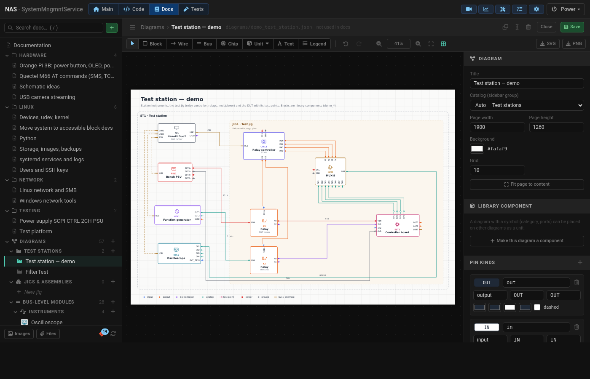
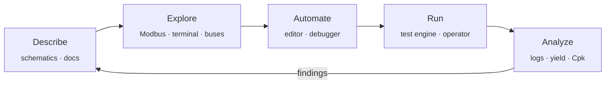
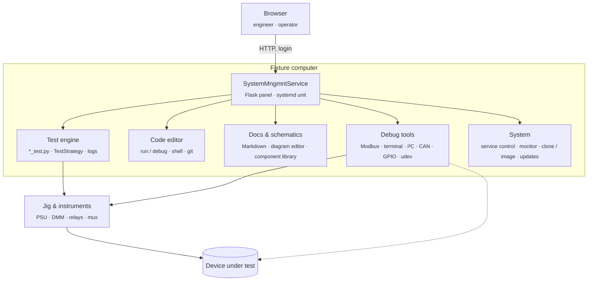
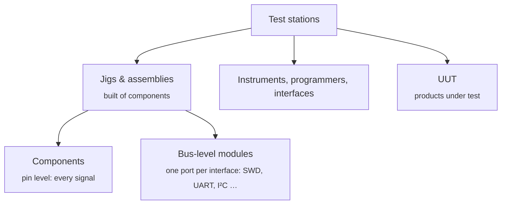
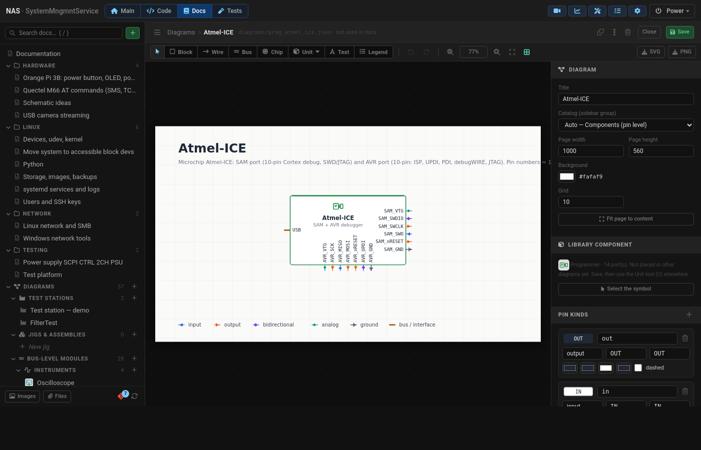
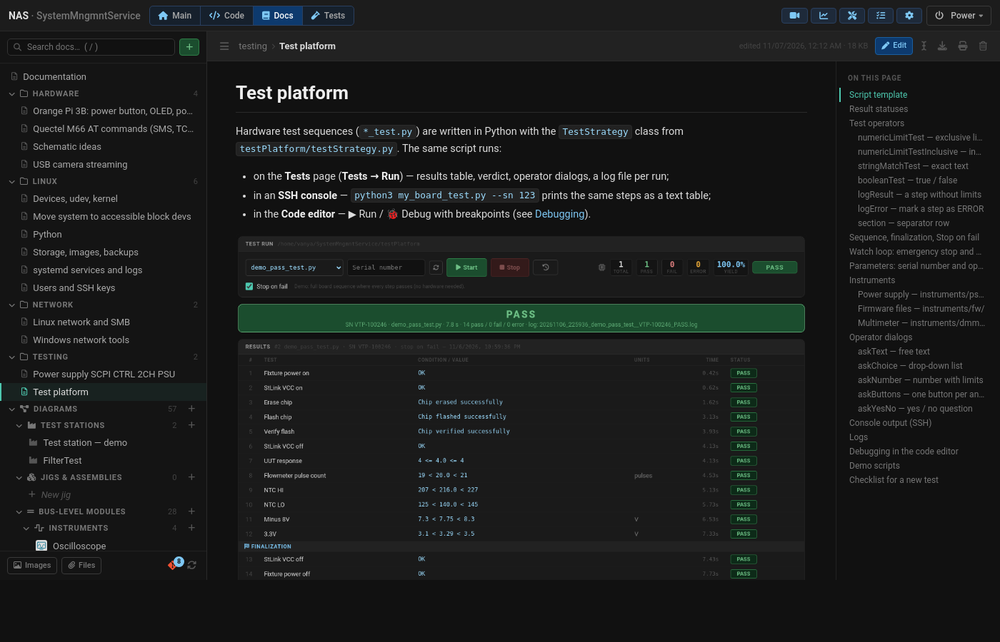
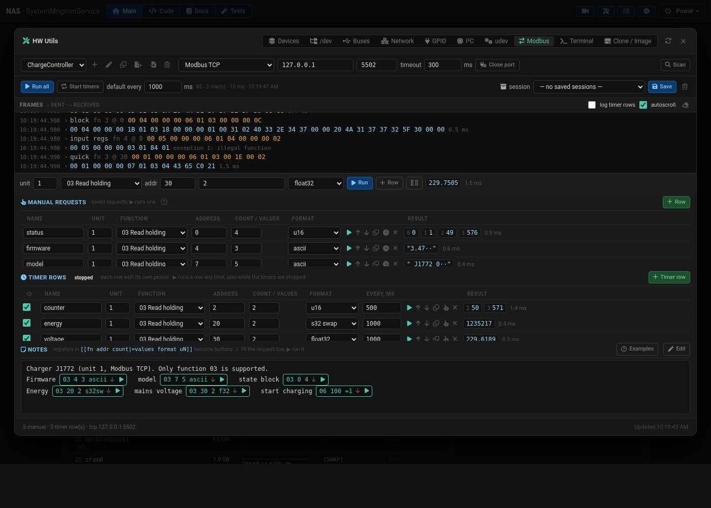
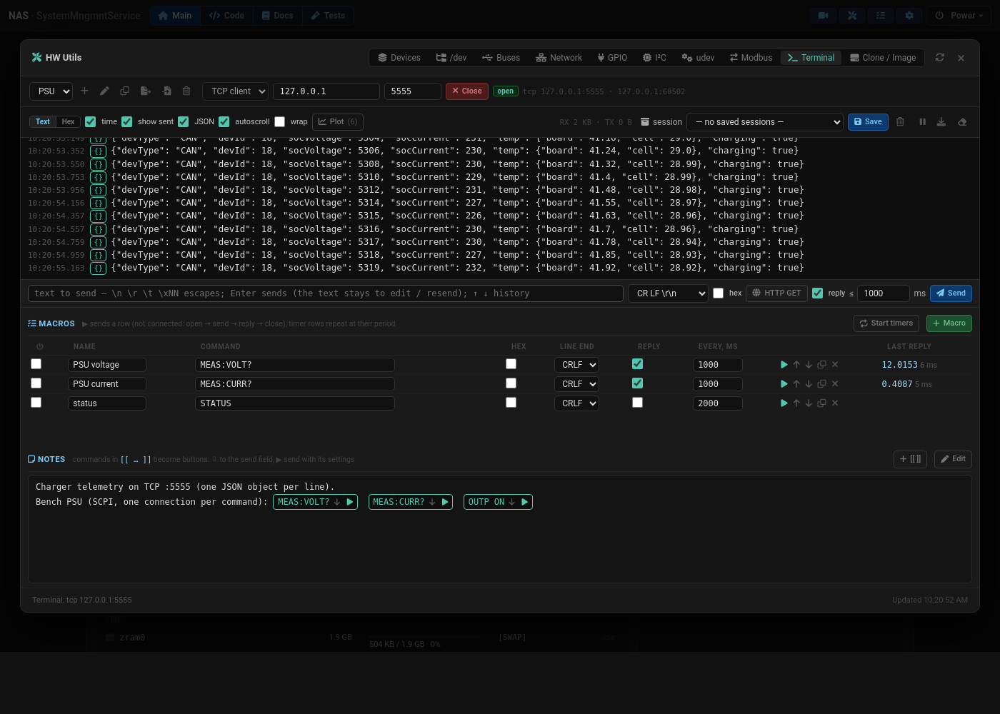
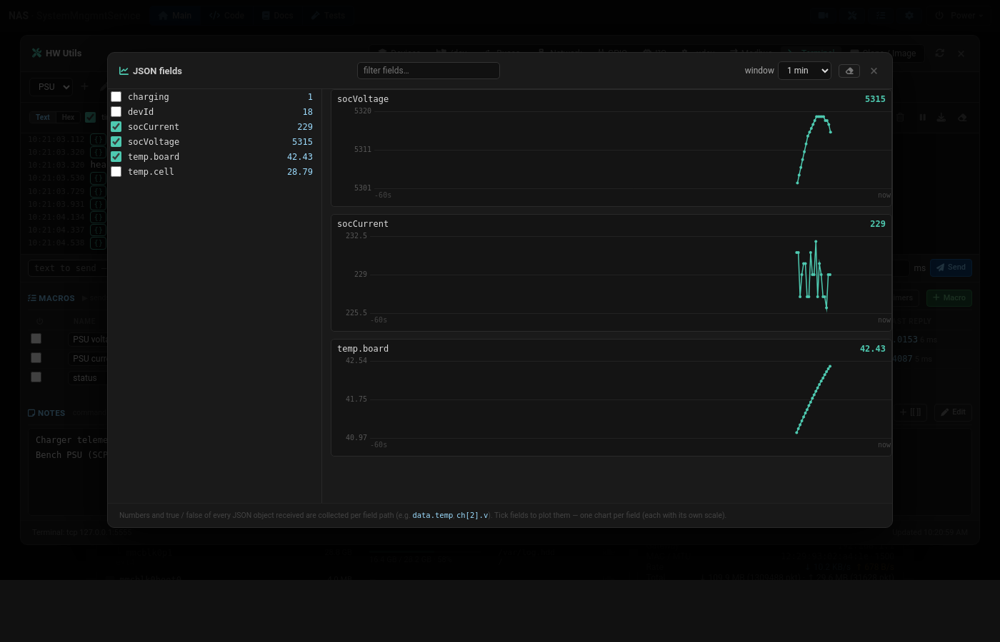
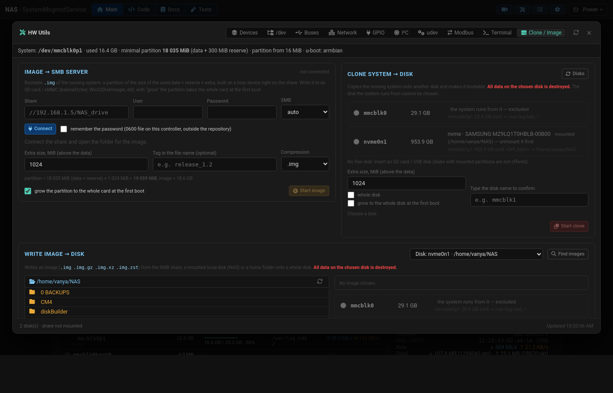

# SystemMngmntService

**A lightweight test platform that lives on the test fixture itself.** One small web panel on the fixture's
single-board computer (OrangePi, NanoPi, Raspberry Pi …) brings together everything a hardware test bench needs:
schematics of the station at every level, a code editor with a debugger, a test engine for the production line,
and tools to debug the device under test — in one browser tab, fully offline.



> Installation, configuration, every tool in detail and the HTTP API: **[docs/MANUAL.md](docs/MANUAL.md)**.

---

## Why

A typical test fixture grows from a pile of separate things: scripts started over SSH, a serial terminal on a
laptop, register maps in a spreadsheet, the wiring of the jig in someone's head or in a CAD file nobody opens,
and test results scattered in text files. Every new station or engineer starts by rebuilding that context.

SystemMngmntService puts the whole context **on the fixture** and makes it reachable from any browser:

- **Describe** the station — a schematic of the station, the jig, the instruments and the UUT, built from a shared
  library of components, embedded in the station's documentation.
- **Explore** the device — Modbus, serial / TCP / UDP terminals, I²C, CAN, GPIO, with macros, timers, notes and
  saved sessions, so a debugging session can be continued tomorrow.
- **Automate** — write the test sequence in the built-in editor, run and debug it step by step on the real fixture.
- **Run** — operators start tests from a simple page: serial number in, PASS / FAIL out, a log per run.
- **Analyze** — yield, first-pass yield, failing steps and per-step value statistics from the logs.

It stays **light**: Flask and plain JavaScript, no build step, no database, no cloud. The only server dependency
is `python3-flask` from apt; everything the browser needs (editor, terminal, icons, charts) is vendored, so the
panel works in closed factory networks and installs from an offline bundle.



## How it fits together

The panel runs as its own systemd unit on the fixture computer, next to the instruments and the device under test,
so it stays reachable even when the application or a test crashes.



---

## Schematics at every level

The documentation has a built-in **diagram editor** (no external CAD): blocks, chips with pinouts, wires and bus
lines, text and legends — saved as an editable model and exported as SVG that the Markdown pages embed. On top of
it sits a **library of test equipment** organised the way a tester is built:



- Every library element is a diagram with a **symbol**: category pictogram, designator prefix and typed ports
  (input, output, bidirectional, analog, test point, power, ground, bus). Ready-made sets include oscilloscopes,
  generators, PSUs, multimeters, IO blocks, multiplexers, relays, controllers, programmers (Atmel-ICE, J-Link,
  PICkit), USB-UART / I²C / SPI / CAN adapters, isolators, USB hubs and LAN switches — at pin level and as
  simplified bus-level modules.
- Place an element on a station or jig with the **Unit** tool; wires attach to ports and take the colour of the
  signal type, so a net keeps one colour from end to end. **Bus lines** carry several signals; signal wires dropped
  on a bus join it and the bus lists what it carries.
- Change a component once — every station that uses it offers **Update**. Duplicate a component into a new version
  with one click, keep catalogs for stations, jigs, components, bus-level modules and UUTs.

| Component library (pin-level symbol) | Docs page with an embedded diagram |
|---|---|
|  |  |

## Test engine

Test sequences are plain Python (`*_test.py`) written with the `TestStrategy` class: numeric limits, string and
boolean checks, operator dialogs, a finalisation that always brings the fixture to a safe state, stop-on-fail and
background watches such as an emergency stop. The same script runs from the **Tests** page, from an SSH console
and in the editor's debugger. Every run writes a log with the serial number; the **Logs** page turns them into
yield, first-pass yield, top failing steps and per-step value distributions with Cpk.

| Test run | Test logs and statistics |
|---|---|
|  |  |


## Code editor

Monaco editor with a file tree of the project, **run and debug Python** on the real fixture (breakpoints,
stepping, variables, hover values), an **interactive shell** in the browser (mc, htop, vim work), the service log,
command macros, a floating documentation window and Git (diff, commit, branches, pull / push).


## Tools for bench debugging

The **HW Utils** window collects the tools you otherwise install on a laptop:

**Modbus** — master for RTU on a serial port, RTU over TCP / UDP (serial servers) and Modbus TCP / UDP. Manual
requests and timer rows with their own periods, formats from u16 to float32 with word swap and ASCII, unit scan,
the raw TX / RX frames, and notes where registers are written as tags — `[[03 4 3 ascii]]` — that fill or run the
request with one click. Profiles per station, research sessions saved to files.



**Terminal** — serial port, TCP client or UDP in one tool. Text or hex view, JSON objects in the stream are parsed
and their fields plotted live; one-shot sends (open → send → reply → close) for instruments with one connection per
command, macros with timers, commands in the notes as buttons, sessions. A flood guard keeps a video stream on the
wrong port from loading the panel.

| Terminal with JSON telemetry, macros and notes | Live plot of JSON fields |
|---|---|
|  |  |

Also in HW Utils: the device list and `/dev`, USB / PCI / I²C buses, network interfaces and **CAN** (bitrate, RX
trace, cyclic TX), **GPIO** view and manual control, **I²C** scan and register read / write, **udev** events and
rules, and **Clone / Image** — copy the running system to another disk, build a bootable image on an SMB share or
write an image to a disk, with the partition sized to the data instead of the whole card.

| CAN, interfaces, routes | GPIO | Clone / Image |
|---|---|---|
|  |  |  |

## Day-to-day operation

The panel also keeps the fixture itself in order: status and restart of the main service (the only thing an
anonymous operator may do), a live system monitor (also as a floating window on every page), backups and deploys
of the application, video preview of cameras, per-host configuration for many stations from one repository, and
self-update from the panel's git upstream.

| Main page | Floating monitor | Anonymous operator view |
|---|---|---|
|  |  |  |

---

## Getting started

```bash
git clone <this repo> && cd SystemMngmntService
sudo ./install.sh        # menu: dependencies (online or from an offline bundle), service unit, start
```

Open `http://<fixture>/`, log in (`admin` / `admin` — change it in **Settings**) and set the target service and
project directories. Everything else — offline bundles, configuration keys, the access model, each page and tool,
the API and how to develop and test the panel — is in **[docs/MANUAL.md](docs/MANUAL.md)**.

## Documentation

| | |
|---|---|
| [docs/MANUAL.md](docs/MANUAL.md) | installation, configuration, pages and tools in detail, HTTP API, project layout, testing |
| `help/` (Docs page in the panel) | the station's own knowledge base: test platform guide, instrument drivers, Linux notes, diagrams |
| [help/testing/test-platform.md](help/testing/test-platform.md) | writing test sequences with `TestStrategy` |
| [tests/README.md](tests/README.md) | the test suite, dev server, screenshots |
| [CLAUDE.md](CLAUDE.md) | rules and architecture notes for contributors and AI assistants |

**Stack:** Python 3 · Flask 3 · plain JavaScript · Monaco · xterm.js · marked · DOMPurify — no build step, no
database, works offline.
