# SystemMngmntService

A self-contained web panel for single-board Linux machines (OrangePi, NanoPi, Raspberry Pi …) that run one
main application as a systemd service — and, optionally, a hardware test fixture.
It runs as its own systemd unit, so it stays reachable when the application crashes or is being redeployed.

Flask 3 + plain JavaScript, no build step; the only server dependency is `python3-flask` from apt.
**Works fully offline** (closed networks): Font Awesome, the Monaco editor and xterm.js are vendored in
`static/vendor`, the monitor charts are drawn on canvas — the browser never contacts the internet.

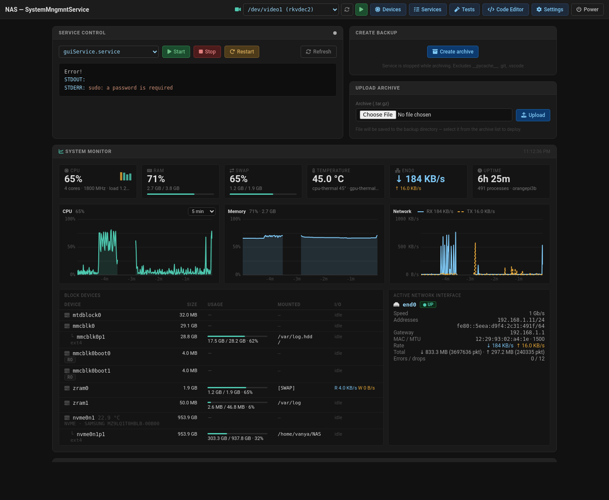

## Features

| | |
|---|---|
| **Service control** | status / start / stop / restart of the target service and any other systemd unit |
| **System monitor** | CPU, RAM, temperature, active network interface and block devices with live charts; on the main page and as a floating, resizable, semi-transparent window on every other page |
| **Backups & deploy** | archive the project, upload a `.tar.gz`, deploy it with an automatic backup |
| **Code editor** | file tree, Monaco editor with outline, **run / debug Python** (breakpoints, step over / into / out, variables, hover values), service log, **interactive terminal** (a real shell: mc, htop, nano, vim), command macros |
| **Test platform** | run `*_test.py` fixture sequences, live PASS/FAIL table, operator prompts, stop-on-fail, a log per run, yield statistics |
| **Log viewer** | filter runs by script / verdict / serial / date, yield and first-pass yield, top failing steps, parsed log view, per-step value analysis (Cpk), CSV export |
| **Docs** | Markdown knowledge base in `help/`: sidebar tree, full-text search, rendered view with table of contents and code copy buttons, Monaco editor with live preview, toolbar, image paste/drop upload, attachments; **diagram editor** for pinouts and block diagrams (exported to SVG, embedded in pages) |
| **Git** | Settings → Git and a Git popup in the code editor and docs: changes with diff, commit (selected files, current or new branch, push after), branches, fetch / pull / push, problem detection with one-click fixes, discard / reset to remote with automatic backup; HTTPS token stored outside the repositories |
| **HW Utils** | logical device list, `/dev` tree, USB/PCI/I²C buses (`lsusb` / `lspci`), network interfaces and **CAN bus** (bitrate, RX trace, TX with repeat timer), **GPIO** viewer and manual control, **I²C** scan + register read/write, **udev** events / rules editor / tools |
| **Video** | preview of V4L2 cameras |
| **Per-host config** | one repository deployed to several machines, each with its own section in `config.json` |
| **Simple access model** | anonymous operators see only the target service (restart) and the read-only monitor; everything else needs a login |

## Screenshots

| Anonymous operator view | Floating monitor on another page |
|---|---|
| 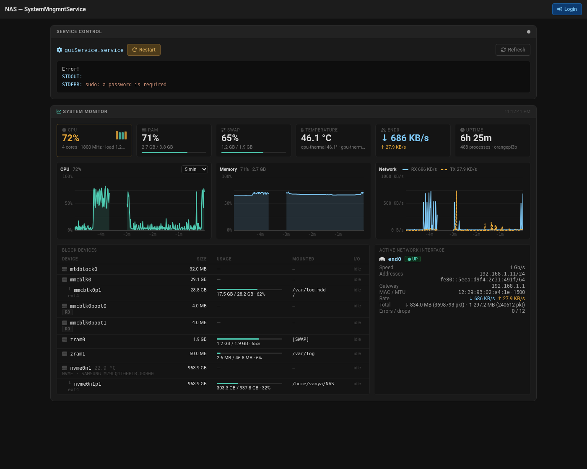 | 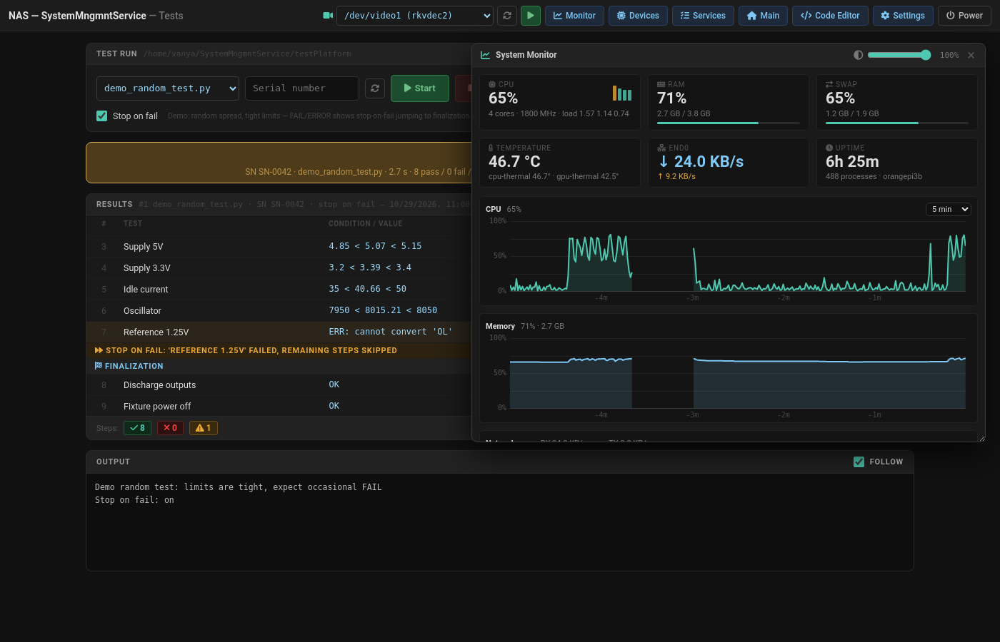 |

| Test platform | Code editor |
|---|---|
| 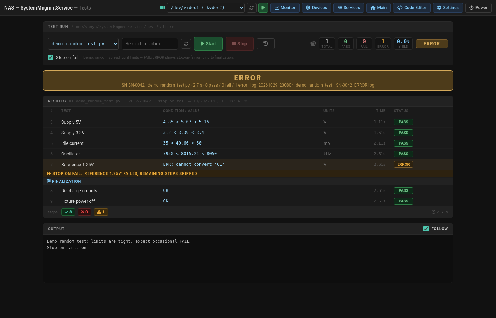 | 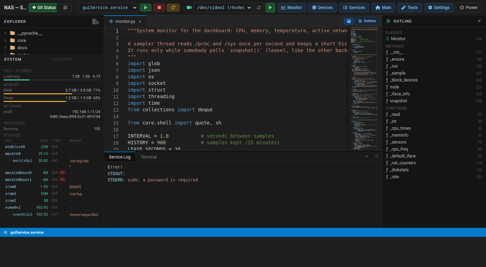 |

| Devices — buses | Devices — network |
|---|---|
| 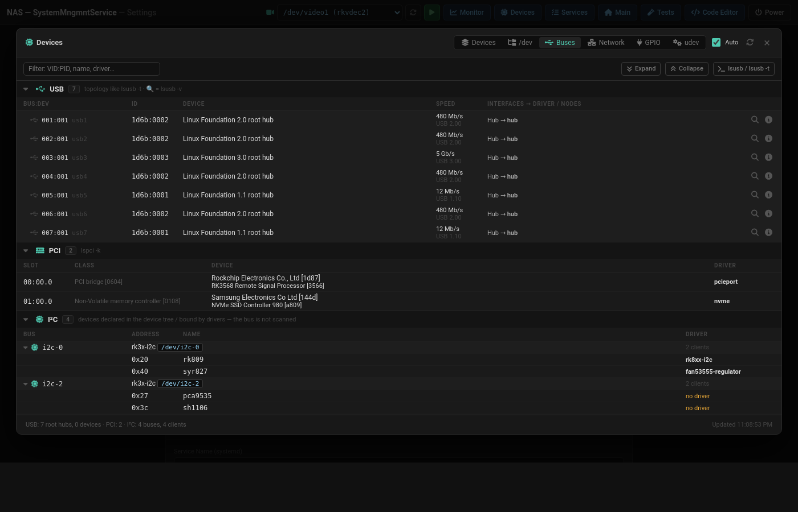 | 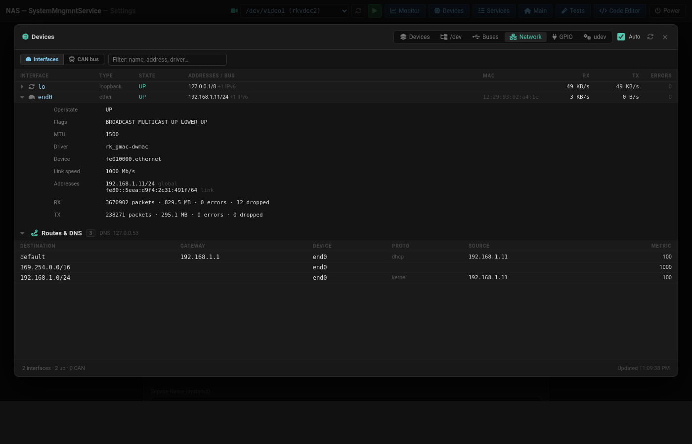 |

| Test log viewer | Step analysis |
|---|---|
| 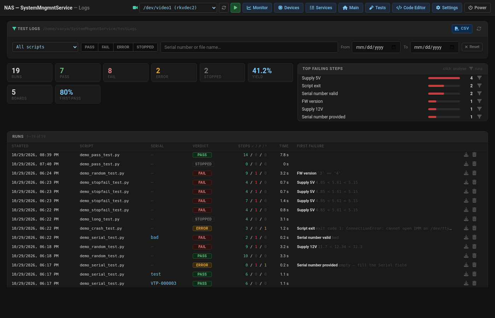 | 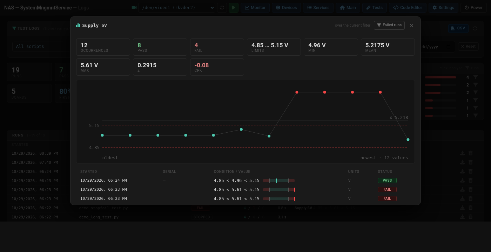 |

| Devices — GPIO | Devices — udev rules |
|---|---|
| 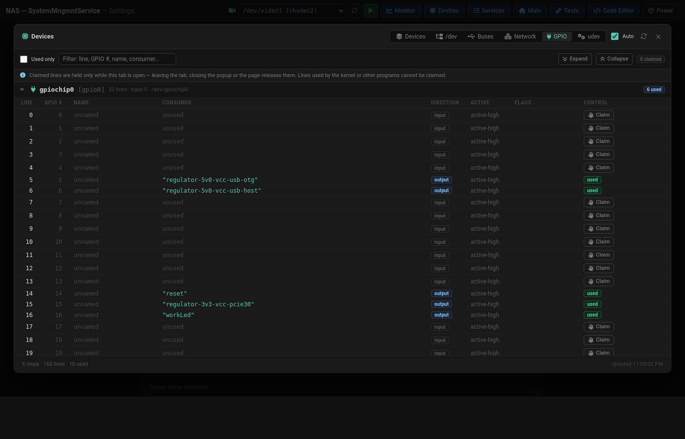 | 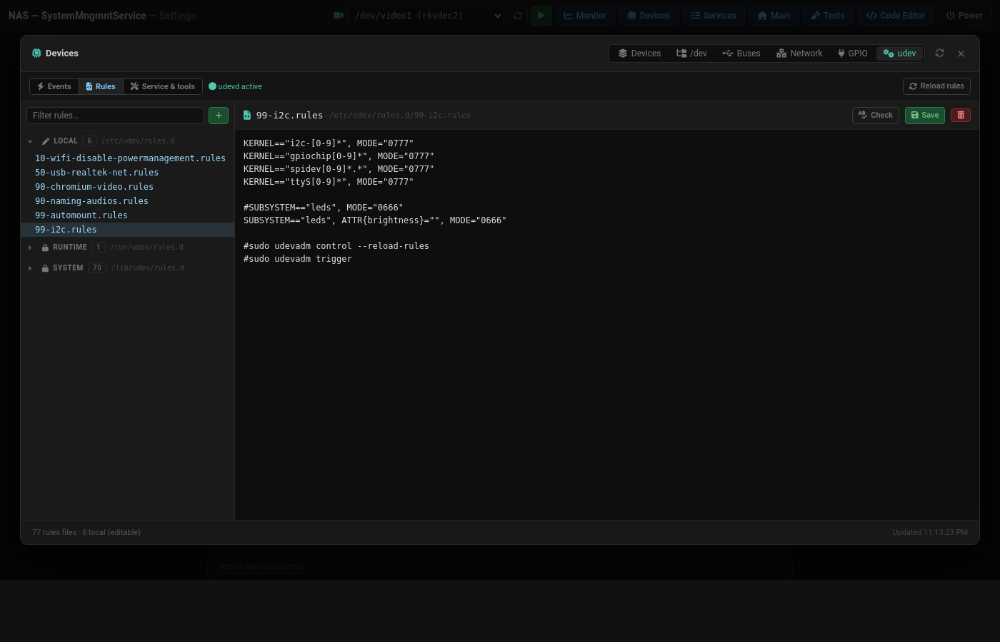 |

## Quick start

```bash
git clone <this repo> && cd SystemMngmntService
sudo ./install.sh           # menu: install dependencies (online/offline), register and start the service
```

Open `http://<device>/`, log in (default `admin` / `admin` — change it in **Settings**) and set the target
service, project and backup directories. See [Installation](#installation) and [Configuration](#configuration-configjson).

### Navigation

The top bar has the work **sections** on the left — **Main**, **Code** (editor), **Docs** (viewer, editor,
diagrams), **Tests** (sub-pages **Run** and **Logs**, shown while the section is open) — and the global tools on the
right: **Video**, **Monitor**, **HW Utils**, **Services**, **Settings** (gear), the **Power** menu (reboot, shutdown,
logout). When the panel's git upstream has new commits (checked every `update_check_minutes` while the panel is
open, only if there is internet), a yellow **⚠** button appears after the power menu: its popup lists the commits,
updates the panel (`git pull --ff-only`, local changes are kept) and restarts it.

---

## Project Structure

```
SystemMngmntService/
├── app.py            # Entry point: creates the Flask app and registers blueprints
├── config.json       # Configuration (paths, port, service, authentication)
├── macros.json       # Code editor command macros
├── core/             # Shared backend: config, auth, shell helpers, navigation, template context
├── routes/           # One Flask blueprint per feature (dashboard, services, backups, editor, ...)
├── templates/
│   ├── base.html     # Common layout: top bar, shared modals and scripts
│   ├── partials/     # Reusable fragments (services modal, video, power menu, update button, flash)
│   ├── index.html    # Main dashboard
│   ├── editor.html   # Code editor
│   ├── settings.html # Settings page
│   └── login.html    # Login page
├── static/
│   ├── css/          # base.css + components.css (shared), <page>.css
│   ├── vendor/       # Font Awesome, Monaco, xterm.js served locally (offline), see vendor/README.md
│   ├── js/           # core.js, services.js, sysinfo.js, monitor.js, video.js, power.js, devices*.js (shared), <page>.js
│   └── img/
├── help/            # Documentation (Markdown), help/img images, help/docs attachments, help/examples raw notes
├── testPlatform/     # Test platform: *_test.py sequences, testStrategy.py / testWatch.py (run from the Tests page)
│   └── instruments/  # Instrument drivers: psu.py, dmm.py, adc.py, stm8_flash.py, uut_serial.py; fw/ = firmware, binaries
├── testLogs/         # One log file per test run (git-ignored)
├── tests/            # Unit/integration tests (unittest) + dev server and screenshot helpers
├── docs/img/         # README screenshots (regenerate with tests/docs_screenshots.sh)
├── CLAUDE.md         # Development rules (for humans and AI assistants)
├── install.sh        # Installer: menu, online/offline install, offline bundles, systemd unit
├── tools/            # offline_bundle.py — builds offline bundles (used by install.sh bundle)
└── setup.sh, setup_offline.sh  # Old entry points, call install.sh online / offline
```

See `CLAUDE.md` for how to add pages and API endpoints.

---

## Configuration (`config.json`)

One config file serves every machine the project is deployed to:

```json
{
    "default": { "target_dir": "...", "service_name": "...", "auth": { ... } },
    "hosts": {
        "orangepi3b": { "device_name": "NAS", "target_dir": "...", ... }
    }
}
```

- The machine is identified by its hostname.
- A host without its own section uses `default` (missing keys fall back to built-in defaults).
- Saving on the Settings page stores the settings in the section of the current host; from then on that host
  uses its own values. "Reset to defaults" on the Settings page removes the section.
- An old flat `config.json` is converted automatically on first start.

Fields (same in `default` and in a host section):

| Field | Description |
|---|---|
| `target_dir` | Target application directory |
| `backup_dir` | Directory for archive storage |
| `archive_name` | Default archive filename |
| `service_name` | Name of the systemd service to monitor |
| `host` / `port` | Panel listen address |
| `auth.enabled` | Enable / disable login |
| `auth.username` / `auth.password` | Credentials |
| `public_service_actions` | Service actions allowed without login (default `["restart"]`) |
| `tests_dir` / `test_logs_dir` | Test scripts / run logs (relative to the project) |
| `help_dir` | Documentation folder (default `help`, relative to the project) |
| `update_check_minutes` | How often the panel checks its git upstream for updates while open (default 60, `0` = off) |

---

## Main Flow

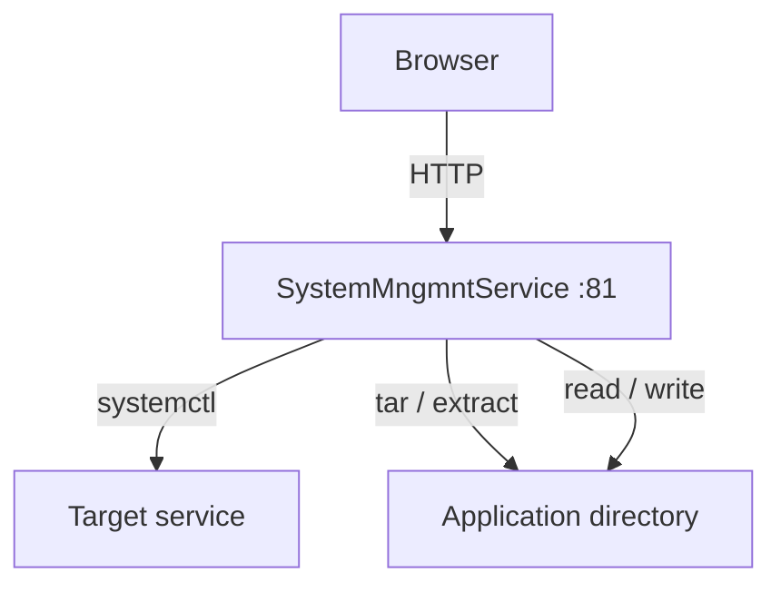

---

## Routes

### Dashboard (`/`)

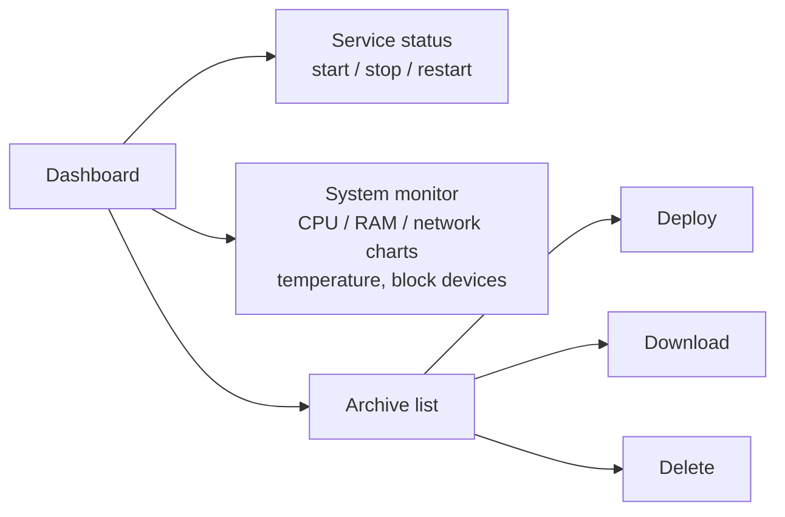

### Backup and Deploy

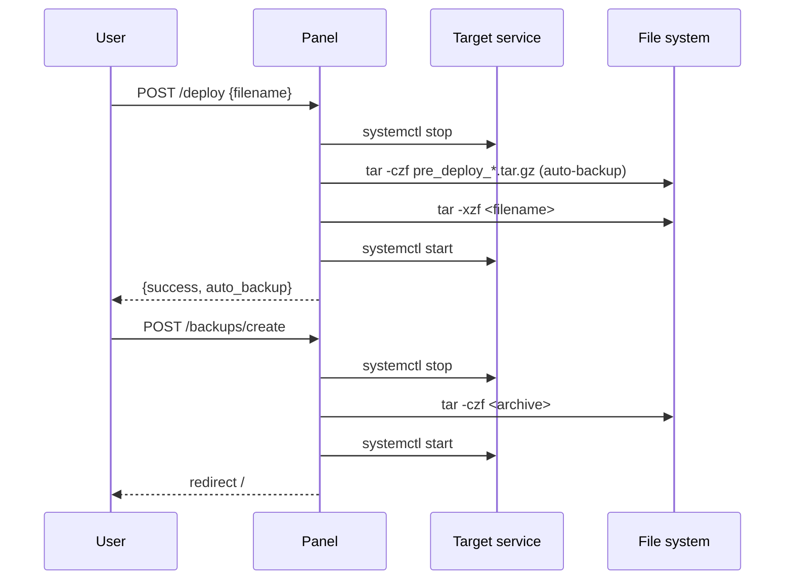

### Code Editor (`/editor`)

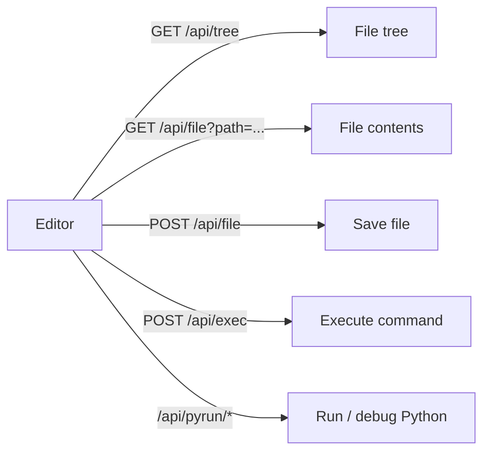

**Terminal.** The *Terminal* tab of the bottom panel is a real shell in a pseudo-terminal, like PuTTY / SSH:
full-screen programs (mc, htop, nano, vim, less), colours, the mouse and F-keys work, the window size follows the
panel (⤢ maximizes it). It runs as the owner of `target_dir`, starting in `target_dir`. Copy: select with the
mouse, then Ctrl+Shift+C (or Ctrl+C while text is selected); paste: Ctrl+V / Ctrl+Shift+V. A page reload
reattaches to the same shell (it is closed 60 s after the last page left); **+** starts a new one. Command macros
are typed into this shell. The output of scripts started with ▶ Run / 🐞 Debug goes to the *Run* tab (keys typed
there go to the script).

**Documentation window.** The **?** button in the editor's top bar opens the documentation in a floating
window (drag the title, resize from the corner): sections → documents → headings on the left with a search over
titles, headings and text, the page on the right in a compact layout. Every line of a code example has *Insert*
(at the editor cursor, indented like the current line) and *Copy* buttons on hover, every block has *Insert* /
*Copy* in its header; a click on `inline code` copies it. It opens on [Test platform](help/testing/test-platform.md).

**Run / debug Python.** The buttons in the tab bar run the open `.py` file (▶, Ctrl+F5) or debug it
(🐞 / Continue F5, Pause F6, Step over F10, Step into F11, Step out Shift+F11, ↶ run the previous line again F7,
Stop Shift+F5). ↶ and *Set next line here* (editor context menu) move the execution point like pdb `jump` —
variables are not undone. Breakpoints: click
left of a line number or F9 (kept per browser). The script runs in a pseudo-terminal — exactly as in an SSH
console — its output appears in the **Terminal** tab and lines typed there go to its stdin (Ctrl+C interrupts).
While paused the line is highlighted and the side panel's **Debug** tab shows the variables (expandable), the
call stack (click a frame), an *Evaluate* box, breakpoints, arguments for the script (e.g. `--sn 12345`, remembered
per file) and *Stop at the first line*; hovering a name in the editor shows its value. Stepping stays in your code
(files under `target_dir`), an uncaught exception pauses where it was raised. Stop quits at the current line, so
`finally` blocks — a test's `finalize` — still run. One session at a time; closing the page stops it, and a
test cannot start on the Tests page while it runs (and vice versa). Starting releases GPIO lines held by the popup.

---

## API

| Method | Route | Access | Description |
|---|---|---|---|
| GET | `/api/services` | public | systemd services (JSON); anonymous: only the target service |
| GET | `/api/status?name=` | public | `systemctl status` output; anonymous: target service only |
| POST | `/api/service/<start\|stop\|restart>?name=` | public for `public_service_actions`, else login | Service action |
| GET | `/api/sysinfo` | login | CPU, RAM, network, disks (JSON; editor side panel) |
| GET | `/api/monitor?since=` | public | System monitor: current CPU/RAM/temperature/active interface/disk I/O, block devices, chart history newer than `since` |
| POST | `/api/power/<reboot\|poweroff>` | login | Reboot / shut down |
| GET | `/api/backups` | login | Archive list (JSON) |
| POST | `/backups/create` | login | Create archive (form) |
| POST | `/backups/upload` | login | Upload archive (multipart form) |
| GET | `/backups/download/<name>` | login | Download archive |
| POST | `/api/backups/deploy` | login | Deploy archive (with auto-backup) |
| POST | `/api/backups/delete` | login | Delete archive |
| GET | `/api/tree[?path=]` | login | One folder of the target directory (the editor loads folders when they are opened) |
| GET/POST | `/api/file` | login | Read / write file |
| POST | `/api/file_create`, `/api/file_rename`, `/api/file_delete` | login | File operations |
| GET | `/api/file_raw` | login | Raw file (image preview) |
| POST | `/api/exec` | login | Execute shell command |
| POST | `/api/term/open` | login | Start a shell in a pty `{cols, rows}` or reattach `{id}` → `{id, user, offset}` |
| GET | `/api/term/stream?id=&from=` | login | Shell output as Server-Sent Events (`out` {d, o}, `exit` {code}) from byte offset `from` |
| POST | `/api/term/input`, `/api/term/resize`, `/api/term/close` | login | Keys `{id, data}` / window size `{id, cols, rows}` / end the shell |
| POST | `/api/pyrun/start` | login | Run / debug a `.py` in target_dir `{path, args, debug, breaks, stop_on_entry}` |
| GET | `/api/pyrun/poll?id=&since=` | login | Session state, new terminal output, pause info (keeps the session alive) |
| POST | `/api/pyrun/cmd`, `/input`, `/stop` | login | `{id, action: continue/next/step/return/pause/frame}` / stdin text / stop |
| POST | `/api/pyrun/eval`, `/vars`, `/breaks` | login | Evaluate while paused (`hover` = names only), variable children, update breakpoints |
| GET/POST | `/api/macros` | login | Editor command macros |
| GET | `/api/video_devices`, `/api/video_resolutions`, `/api/video_feed` | login | Video streaming |
| POST | `/api/video_stop` | login | Stop video stream |
| GET | `/api/browse` | login | Browse directories (settings path picker) |
| GET | `/api/devices/dev` | login | `/dev` tree (type, maj:min, mode, owner, symlink target) |
| GET | `/api/devices/dev/info?path=\|devpath=` | login | `udevadm info` properties of a node in `/dev` or a `/devices/...` path |
| GET | `/api/devices/list` | login | Device nodes from the udev database, grouped by kind |
| GET | `/api/devices/buses` | login | USB topology, PCI devices, I²C adapters and clients |
| GET | `/api/i2c/buses` | login | I²C adapters with kernel clients, saved labels, address hints (no bus access) |
| POST | `/api/i2c/scan`, `/api/i2c/read`, `/api/i2c/write` | login | `{bus, mode}` / `{bus, addr, reg, width, length, force}` / `{bus, addr, reg, width, data, force}` |
| POST | `/api/i2c/label` | login | Name a device `{bus, addr, label}` (empty removes it) |
| GET | `/api/devices/usb/verbose[?bus=&dev=]` | login | `lsusb -v -s bus:dev`, or `lsusb` + `lsusb -t` |
| GET | `/api/devices/gpio` | login | GPIO chips and lines like `gpioinfo` (read-only, libgpiod v1/v2) |
| GET | `/api/devices/gpio/ctl?client=` | login | Lines held by a popup client with live values (also renews its lease) |
| POST | `/api/devices/gpio/ctl` | login | `{client, action: claim\|input\|output\|set\|release\|release_all, chip, offset, value}` |
| GET | `/api/net/interfaces` | login | Interfaces (state, addresses, counters, CAN bit timing), routes, DNS |
| POST | `/api/net/can/link` | login | `{iface, action: open\|close, bitrate, sample_point, restart_ms, listen_only}` |
| GET | `/api/net/can/frames?iface=&since=` | login | New CAN frames + cyclic jobs; polling keeps the socket open |
| POST | `/api/net/can/send` | login | `{iface, action: send\|cyclic\|stop\|stop_all\|clear, id, ext, rtr, data, period_ms, job}` |
| GET | `/api/udev/status` | login | systemd-udevd state, udev version, rules counts, subsystems |
| POST | `/api/udev/action` | login | `{action: reload\|restart\|trigger\|test\|attrs, kind, subsystem, device, devpath, all}` |
| GET | `/api/udev/events?since=` | login | New monitor events; polling keeps `udevadm monitor` running |
| POST | `/api/udev/events/clear` | login | Clear the event buffer |
| GET | `/api/udev/rules` | login | Rules files of `/etc`, `/run`, `/lib` with override info |
| GET | `/api/udev/rule?dir=&name=` | login | Read one rules file |
| POST | `/api/udev/rule` | login | Save `{name, text, force}` to `/etc/udev/rules.d` (422 on syntax problems unless `force`) |
| POST | `/api/udev/rule/check` | login | Syntax check `{text}` → `{problems: [{line, message}]}` |
| POST | `/api/udev/rule/delete` | login | Delete `{name}` from `/etc/udev/rules.d` |
| POST | `/api/settings` | login | Save settings |
| GET | `/api/tests/scripts` | login | Test scripts (`*_test.py` in `tests_dir`) |
| POST | `/api/tests/start` / `/api/tests/stop` | login | Start `{script, serial, stop_on_fail}` / stop the running one |
| GET | `/api/tests/status?run_id=&results_from=&output_from=` | login | Current run, incremental results, output and pending operator prompt |
| POST | `/api/tests/answer` | login | Answer the pending operator prompt `{run_id, prompt_id, value}` |
| GET | `/api/tests/logs`, `/api/tests/logs/<name>[?download=1]` | login | Run history / log file |
| POST | `/api/tests/logs/delete` | login | Delete `{name}` or `{all: true}` |
| GET | `/logs` | login | Test log viewer page |
| GET | `/api/logs?script&verdict&q&from&to&step&offset&limit` | login | Filtered runs (newest first) + statistics (yield, first-pass yield, top failing steps) |
| GET | `/api/logs/view/<name>` | login | One log parsed into header, steps, sections, output, operator Q/A, footer |
| GET | `/api/logs/step?name=&…filters` | login | One step across the filtered runs: values, min/mean/max/σ, Cpk |
| GET | `/api/logs/export.csv?…filters` | login | Filtered runs as CSV (one row per run) |
| GET | `/api/tests/stats?script=` | login | Board counts per verdict for a script |
| GET | `/api/git/repos`, `/api/git/status?repo=`, `/api/git/summary?repo=`, `/api/git/diff?repo=&path=` | login | Repositories (project, panel, docs), full status + problems, badge counts, diff of a changed file |
| POST | `/api/git/commit`, `/branch`, `/checkout`, `/branch_delete`, `/fetch`, `/pull`, `/push`, `/discard`, `/reset`, `/fix`, `/identity` | login | Git actions `{repo, …}`; every answer carries the new status |
| GET | `/api/git/tree_status` | login | Changed files of target_dir's repositories (editor tree marks) |
| POST | `/api/git/clone`, `/api/git/init` | login | Clone `{url, name}` into target_dir / initialize target_dir |
| GET / POST | `/api/git/credentials` | login | HTTPS username + token (write-only: only `token_set` / last 4 chars come back) |
| GET | `/api/update/status[?force=1]` | login | Panel update check: commits the panel repo is behind its upstream (fetch runs in the background) |
| POST | `/api/update/apply`, `/api/update/restart` | login | `git pull --ff-only` of the panel / restart the panel's own systemd unit |
| GET | `/help[?doc=<path>]` | login | Documentation viewer / editor |
| GET | `/help/file/<path>[?dl=1]` | login | Image, attachment or raw page from `help_dir` (sandboxed) |
| GET | `/api/help/tree` | login | All pages `{path, title, mtime, size}` |
| GET / POST | `/api/help/doc` | login | Read `?path=` / save `{path, content, mtime, force}` (409 if changed since `mtime`) |
| POST | `/api/help/create`, `/api/help/rename`, `/api/help/delete` | login | `{path, title}` / `{path, new_path}` (fixes img/docs links) / `{path}` (moved to `.trash/`) |
| GET | `/api/help/search?q=` | login | Pages containing every word, with matching lines |
| GET | `/api/help/assets?kind=img\|docs` | login | Images / attachments with the pages that use them |
| POST | `/api/help/upload` | login | Multipart `kind` + `file`(s); returns the stored names |
| POST | `/api/help/asset_delete` | login | `{kind, name}` (moved to `.trash/`) |
| GET | `/api/help/diagrams`, `/api/help/diagram?name=` | login | Diagram list / one diagram model with the pages that embed it |
| POST | `/api/help/diagram/create`, `/save`, `/rename`, `/delete` | login | `{name, data, svg}` / `{name, data, svg, mtime, force}` (409 on conflict) / `{name, new_name}` (fixes page links) / `{name}` |

---

## System monitor

The **System Monitor** card on the main page is public (read-only, also for anonymous visitors); for
logged-in users the **Monitor** button in the top bar of every other page opens the same view in a floating window (drag by the title bar, resize from the
bottom-right corner, opacity slider, ×). Position, size, opacity and the open state are remembered in the
browser, so the window stays open while moving between pages.

- Tiles: CPU % (per-core bars, frequency, load average), RAM, swap, temperature (all thermal zones, CPU first),
  active network interface rates, uptime / processes.
- Charts (1 / 5 / 15 min window, hover for values): CPU %, RAM %, network RX/TX of the active interface.
- Block devices (`lsblk`, loop/ram skipped): size, model/transport, NVMe temperature, filesystem/swap usage,
  mount points, read/write rate and busy %.
- Active interface = the default route with the lowest metric (otherwise the first link that is up):
  state, carrier, speed, addresses, gateway, MAC/MTU, totals, errors/drops.

`core/monitor.py` samples `/proc` and `/sys` once per second and keeps 15 minutes of history. The sampler
runs only while the page polls `/api/monitor` (30 s lease); the browser polls every 2 s and pauses in a hidden tab.

---

## HW Utils popup

The **HW Utils** button in the top bar (logged in) opens a popup with seven tabs. With *Auto* on, the
current view refreshes every 2–3 s; new devices are highlighted, added/removed ones are listed in the
footer (plus a toast, except `/dev/pts`, `/dev/shm`). All groups, trees, chips, bus sections and rules
directories start collapsed (a filter expands what matches; *Expand* / *Collapse* buttons). Clicking a device opens a side panel with its udev
properties and actions: *Attributes* (`udevadm info -a`), *Test rules* (`udevadm test`, dry run),
*Trigger change*, *New rule…* (drafts a rule matching the device and opens it in the rules editor).

- **Devices** — the udev database grouped by kind: serial ports, USB, video, I²C, SPI, GPIO, storage,
  input, sound, network, display, other, virtual (hidden by default). Human names (hwdb vendor/model,
  V4L product, disk model/size/filesystem), driver, VID:PID, symlinks.
- **/dev** — the device node tree (symlinks are not followed) with a group and a text filter.
- **Buses** — USB topology like `lsusb -t` (VID:PID, hwdb names, serial, speed, interface class → driver,
  device nodes of each device; 🔍 = `lsusb -v`), PCI (`lspci -k`), I²C adapters with the clients the kernel
  knows about (the bus is never scanned).
- **Network**
  - *Interfaces* — every interface with type, state, IPv4/IPv6, MAC, RX/TX rate and errors; a row expands to
    MTU, driver, link speed, packet counters (and bit timing / bus state / error counters for CAN).
    *Routes & DNS* below. Read-only: interfaces other than CAN are never reconfigured.
  - *CAN bus* — SocketCAN tool for `can*` / `vcan*`: *Open* applies bitrate, sample point, restart-ms,
    listen-only (`ip link set … type can …`, root) and brings the link up, *Close* brings it down (vcan: up/down
    only). Frames (RX, own TX, error frames with decoded class) in *Trace* or *By ID* (count, period, changed
    bytes highlighted). Send a frame (hex ID, Ext, RTR, hex data) or *Start repeat* every N ms; running
    repeats are listed with counters and a Stop button. The socket and all repeats exist only while the
    CAN view is open (leaving it stops the repeats, an idle client loses them after 10 s). Configuration is
    locked while a test script runs; starting a test stops all repeats.
- **GPIO** — every `/dev/gpiochip*` with its lines: offset, global sysfs number (`base + offset`), name,
  consumer, direction, active level, bias/drive flags. Without the Python `gpiod` module the raw
  `gpioinfo` output is shown.
  *Claim* requests a free line "as is" (its state is not changed), then it can be switched IN/OUT, an output
  toggled 0/1, an input level is read every second. Lines are held only while the GPIO tab is open:
  switching the tab, closing the popup or the page releases them, and a client that stops polling loses
  them after 6 s (`core/gpio_ctl.py`, `LEASE_SECONDS`). Claiming is refused while a test script runs, and
  starting a test releases every web-held line.
- **I²C** — `i2cdetect`-style grid of a bus (pick `i2c-N`): *Scan* probes addresses 0x03–0x77 (auto / quick
  write / read byte) — only when pressed, never on its own. Cells: green = answers and has a name (kernel client
  or your label), orange = answers, unknown (with a "maybe: …" hint of typical chips), blue `UU` = bound to a
  kernel driver, dashed red = declared in the device tree / labelled but no answer. Click an address: *Read*
  `Len` bytes from a register (8-bit, 16-bit or no register address — `i2ctransfer` with repeated start;
  hex dump + u16/s16/u32 values), *Write* hex bytes (`C3,83`, `0xc3 0x83`). Driver-bound addresses need *Force*.
  ✎ names a device (stored per host in `config.json` → `i2c_labels`). All transactions are logged on the right.
  Locked while a test script runs.
- **udev**
  - *Events* — live `udevadm monitor --kernel --udev --property` (filter by source, text; pause; click an
    event for its properties). The monitor process runs only while this view is polled and stops 10 s
    later (`core/udev.py`, `UdevMonitor`).
  - *Rules* — rules files of `/etc/udev/rules.d` (editable), `/run/udev/rules.d` and `/lib/udev/rules.d`
    (read-only, *Override in /etc* copies one into `/etc`). Overridden files are marked. *Check* runs a
    built-in syntax check (`udevadm verify` needs systemd ≥ 254); Save asks before writing a file with
    problems. Changes apply after *Reload rules*.
  - *Service & tools* — `systemd-udevd` status, restart, reload rules, `udevadm trigger` (by subsystem
    and/or device), `udevadm test`, attribute walk.

## Test log viewer (`/logs`)

Browses the run logs in `test_logs_dir` (`testLogs/`), written for every run started from the Tests page
(**Tests → Logs** in the top bar, or **Log viewer** on the Tests page).

- Filters: script, verdict (PASS / FAIL / ERROR / STOPPED, several at once), serial number or file name,
  date range, "failed at step". The filter is kept in the URL (`/logs#verdict=FAIL&q=SN-1`), so a view can be linked.
- Statistics over the filter: runs per verdict, yield (stopped runs excluded), distinct boards, first-pass yield
  (first finished run of each serial), top failing steps.
- Run list with first failure, 100 per page; click a serial to see every run of that board; CSV export.
- Log view: steps with status and a limit bar showing where the measured value lies between its limits,
  sections (stop-on-fail, finalization), operator prompts/answers, script output (can be hidden), raw text,
  search, ←/→ to move to the newer/older run.
- Step analysis (click a step name): every value of that step across the filtered runs, run chart with limits
  and mean, min / mean / max / σ / Cpk.

`core/test_logs.py` parses the log format of `core/test_runner.py` (fixed columns: name 40, condition 28, units)
and caches parsed files by mtime/size.

---

## Git (Settings → Git, Git icon in the editor and docs)

Works on the repositories of `target_dir` (*Project*), the panel itself and `help_dir` (*Docs*) — folders in one
worktree are shown once — plus every repository found inside `target_dir` (projects cloned from GitHub etc.,
up to 3 levels deep, id `dir:<relative path>`).

- **Code editor**: change marks in the file tree (M / U / D, a dot on folders with changes), the branch next to the
  root folder of every repository, the repository of the open file in the status bar (branch, changes, ahead/behind,
  GitHub/GitLab remote), *Commit* next to Save (opens the Git popup with that file selected), the Git icon opens
  the repository of the open file.
- Not a repository: clone a project (https / ssh / `git@host:owner/repo`; private https repos use the token) into
  `target_dir/<folder>`, or `git init`.

- Status: branch (switch from the list), ahead/behind the upstream, changed files with diff.
- Commit the selected files to the current branch or to a new one, optionally push right after.
- Branches: create & switch, switch, delete (asks before deleting an unmerged one). Fetch, pull (`--ff-only`), push
  (sets the upstream on the first push).
- **Problems** with fixes: root-owned files in `.git` (chown back), stale `index.lock`, merge / rebase in progress
  (abort), conflicts, missing user name / e-mail, detached HEAD (create a branch), no upstream, behind / diverged
  (pull rebase / merge / reset to remote), credentials inside a remote URL (strip), tracked `.secret_key` (untrack),
  the token found in tracked or staged files, credentials file inside a repository.
- Discard changes, **Reset to remote** — always creates `backup/<date>` at the old HEAD and stashes uncommitted work.
- git runs as the owner of the repository (the panel runs as root), non-interactive, with timeouts.
- **Token**: kept in `~/.config/systemmngmntservice/credentials.json` of the panel user (`/root/...` for the
  service), mode 600, outside every repository and never in `config.json`; the browser can only replace or remove
  it. Git receives it through a one-shot credential helper reading an environment variable of that one process —
  nothing is written to `.git/config` or remote URLs, and command output is scrubbed of it.

---

## Documentation (`/help`)

A Markdown knowledge base kept in `help_dir` (`help/`), **Docs** in the top bar (login only).

| Folder | Content |
|---|---|
| `help/*.md`, `help/<folder>/*.md` | pages; folders (up to 3 levels) are sections of the sidebar tree |
| `help/img/` | images (pasted / dropped into the editor are uploaded here) |
| `help/docs/` | attached files, rendered as file buttons |
| `help/diagrams/` | diagrams: `<name>.json` (model) + `<name>.svg` (written on every save) |
| `help/examples/` | raw notes, not listed |
| `help/.trash/` | deleted pages and files |

- View: rendered GitHub-flavoured Markdown (tables, task lists, `> [!NOTE]` boxes), highlighted code with a Copy
  button, table of contents with scroll tracking, image zoom, print. `?doc=<path>#<heading>` links to a section.
- Search (`/`): every word must occur; results show matching lines, the opened page highlights them.
- Edit (`E`): Monaco with live preview (editor / split / preview), formatting toolbar, `Ctrl+S` / `B` / `I` / `K`,
  paste or drop images and files to upload and link them, link to another page; saving detects concurrent changes.
- Links are relative to the page (`img/x.png`, `../docs/f.zip`, `other.md#section`), so the files also render
  in VS Code or Git. Rename/move rewrites the `img/` and `docs/` links for the new folder depth.
- Rendering uses vendored marked + DOMPurify + highlight.js; served files get a sandbox CSP.
- **Diagrams** (sidebar group *Diagrams*, `?diagram=<name>`; only inside the Docs page): SVG editor with
  chips/modules with pins on four sides ("tags" or "simple" pin style, pin kinds with legend), blocks, wires/arrows
  attached to blocks (orthogonal auto-route, bend points, labels), text and legend; grid snap, zoom/pan,
  multi-select, align, copy/paste, undo/redo. Pins are edited in a table that accepts rows pasted from Excel/CSV.
  Saving writes `<name>.json` and the exported `<name>.svg`; pages embed `../diagrams/<name>.svg` (toolbar button),
  and a diagram image in a page has an *Edit diagram* button. SVG/PNG download.

---

## Test Platform (`/tests`)

- Scripts: every `*_test.py` in `tests_dir` (default `testPlatform/`); the first line of the module docstring is
  shown as the description. Demo scripts (`demo_*_test.py`) need no hardware.
- A script runs as a child process (`python3 -u`, cwd = `tests_dir`, env `TEST_RUNNER=1`). Only one run at a time.
  Stdin receives one Enter and is closed, so interactive scripts run exactly one sequence.
- `testStrategy.TestStrategy` prints `@@RESULT {"name","condition","units","status"}` lines in runner mode;
  all other output is shown in the *Output* panel and written to the log.
- Verdict: `STOPPED` (Stop pressed: SIGINT, SIGKILL after 3 s), `ERROR` (any ERROR result, non-zero exit code,
  or no results), `FAIL` (any FAIL), otherwise `PASS`.
- Stop on fail + finalization: structure a script as `ts.run(steps, finalize)`. With the *Stop on fail* checkbox
  (checked by default; env `TEST_STOP_ON_FAIL=1`, or `--stop-on-fail` in a terminal) the first FAIL/ERROR skips the
  remaining steps. `finalize` (power off, relays to a safe state) always runs: after pass, fail, an exception or
  Stop (SIGINT; the runner waits 10 s before SIGKILL). Scripts without `ts.run()` are not affected.
  Separator rows (`ts.section(title)`) are shown in the results. Demo: `demo_stopfail_test.py`.
- Serial number: the *Serial number* field is passed to the script as `--sn <serial>` (letters, digits, `-_.`,
  up to 64 chars; empty = no argument). In a script: `ts.serial`. Enter in the field starts the test (barcode
  scanners); after a run the field is selected for the next unit. Demo: `demo_serial_test.py` (valid: `test`
  or `VTP-123456`).
- Logs: `test_logs_dir/<YYYYmmdd_HHMMSS>_<script>[__<serial>]_<VERDICT>.log` (`.running` while in progress).
  The *History* popup lists them (with serial) and can delete one log or all logs (the running log is kept).
- Board statistics (Test Run panel): PASS / FAIL / ERROR boards and yield for the selected script, counted from
  the logs (stopped runs excluded; clearing the history resets them). Step counters of the current run are shown
  under the results table.
- Operator input steps (`TestStrategy` methods; in a terminal they fall back to `input()`):

  | Method | Web UI | Returns |
  |---|---|---|
  | `askText(name, message, default="")` | text field (empty not accepted) | `str` |
  | `askNumber(name, message, lo=None, hi=None, units="", default=None)` | number field, range-checked | `float` |
  | `askChoice(name, message, options, default=None)` | drop-down | selected option |
  | `askButtons(name, message, buttons=("OK",))` | one button per option | pressed label |
  | `askYesNo(name, message)` | Yes / No buttons | `bool` |

  The script prints `@@PROMPT {json}` and blocks; the answer comes back as a JSON line on the pipe from
  `TEST_RUNNER_ANSWER_FD`. The answer is logged as an `INFO` step (does not affect the verdict); check it with
  the regular test methods. Demo: `demo_operator_test.py`.

## Installation

```bash
sudo ./install.sh                 # interactive menu (whiptail; --plain for text prompts)
./install.sh status               # what is installed, service state, available offline bundles
```

| Command | What it does |
|---|---|
| `sudo ./install.sh online` | `apt-get install` the packages of the selected components + Flask 3 with pip (PyPI) |
| `sudo ./install.sh offline` | the same from an offline bundle in `setup_data/` (no network) |
| `./install.sh bundle --arch armhf,arm64 --suite bookworm` | build offline bundles on a machine with internet (no root) |
| `sudo ./install.sh service` | write `/etc/systemd/system/systemmngmntservice.service` if it changed, enable it, (re)start the panel |
| `sudo ./install.sh uninstall` | stop and remove the unit (project, `config.json` and packages stay) |

Options: `--components core,git,gpio,devices,video` (default `core,git,gpio,devices`), `--bundle DIR|FILE.tar`,
`--yes` (no questions — for scripts). Every step is idempotent; a running panel is restarted only after a confirmation.

| Component | Packages |
|---|---|
| `core` (always) | python3, python3-markupsafe, python3-pip, sudo, iproute2, whiptail; Flask 3 + werkzeug, jinja2, itsdangerous, click, blinker via pip |
| `git` | git |
| `gpio` | python3-libgpiod, gpiod, python3-serial, python3-smbus (GPIO popup, test platform) |
| `devices` | usbutils, pciutils, i2c-tools, can-utils |
| `video` | ffmpeg (~100 MB with its libraries) |

### Offline installation (Allwinner H3 / H5 boards without internet)

x86 machines always install online; offline bundles are for the ARM boards: **armhf** = H3 (32-bit),
**arm64** = H5 (64-bit). Build them on any Debian/Ubuntu machine with internet — apt runs in a private directory
with the target architecture, the build machine is not changed (needs `debian-archive-keyring` and `pip`):

```bash
./install.sh bundle --arch armhf,arm64 --suite bookworm     # or: ./install.sh → "bundle"
# → setup_data/smms-offline-bookworm-armhf.tar (~56 MB), smms-offline-bookworm-arm64.tar (~59 MB)
```

Copy the project and the matching `.tar` (into `setup_data/`) to the board and run `sudo ./install.sh offline`.
The bundle is a local apt repository with the selected packages and everything they need beyond the Debian base
system, plus the Flask wheels: apt skips what is already installed in the same or a newer version. The suite must
match the board's Debian release (`./install.sh status` shows what it needs, e.g. `bookworm-armhf`).
`setup_data/` is git-ignored — bundles are not stored in the repository.

The old installer set `cap_net_bind_service` on the system `python3`; it is not needed (the service runs as root) —
`./install.sh status` shows the command to remove it.

### Service management

```bash
sudo systemctl status systemmngmntservice.service
sudo systemctl restart systemmngmntservice.service
journalctl -u systemmngmntservice.service -f
```

---

## Testing

The tests use only the standard library (`unittest`) and never touch the live service, `config.json`
or `testLogs/` (they work on temporary copies):

```bash
python3 -m unittest discover -s tests -t . -q          # whole suite, ~20 s
python3 -m unittest tests.test_access -q               # one module
```

| Module | Covers |
|---|---|
| `test_access.py` | access matrix: anonymous / logged in / auth disabled |
| `test_config.py` | legacy migration, per-host sections, save / reset |
| `test_monitor.py` | `/api/monitor` payload, sampler lease, active interface detection |
| `test_logs.py` | log parsing, filters, yield/FPY, step statistics, CSV, `/api/logs*` |
| `test_help.py` | docs paths, store (create/save conflict/rename relink/trash/search), uploads, `/api/help*`, `/help/file` |
| `test_git.py` | git on temporary repositories: commit/branch/push/pull, problems + fixes, reset backup, token never leaks |
| `test_test_runner.py` | operator answer validation, real runs of the demo scripts, stop |
| `test_offline.py` | no external (CDN) URLs in templates/static, vendored libraries are served |
| `test_net.py`, `test_udev.py`, `test_shell.py` | CAN frame parsing, udev rule linter, path/command helpers |

Visual checks: `python3 tests/devserver.py` starts a second instance on port 5099 (login disabled in memory,
`?js=` hook for opening popups), `tests/screenshot.sh <path> <out.png>` takes a headless Chromium screenshot,
`tests/docs_screenshots.sh` regenerates the images in `docs/img`. See [tests/README.md](tests/README.md).

---

## Authentication

When `auth.enabled = true`:
- **anonymous visitors** see only the *Service Control* block for the target service (`service_name`) — no
  service selector and no *All Services* list — and may run the actions listed in `public_service_actions` on it;
  below it they see the read-only *System Monitor* dashboard;
- **logged-in users** get everything else (backups, system info, code editor, terminal, settings, video, power).

When `auth.enabled = false`, every visitor has full access.
Credentials are stored in `config.json` and can be changed via `/settings`.
