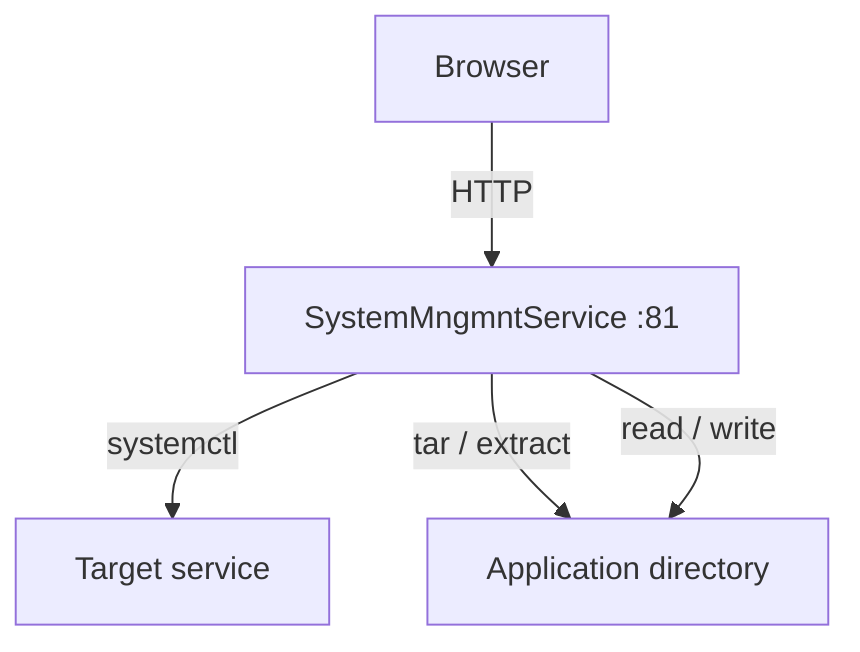
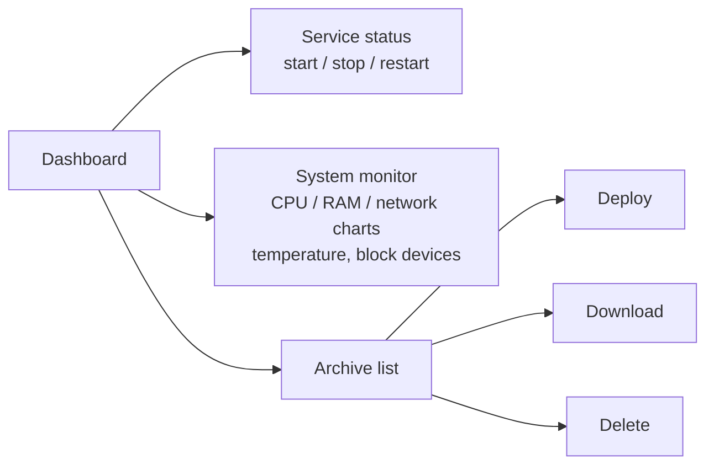
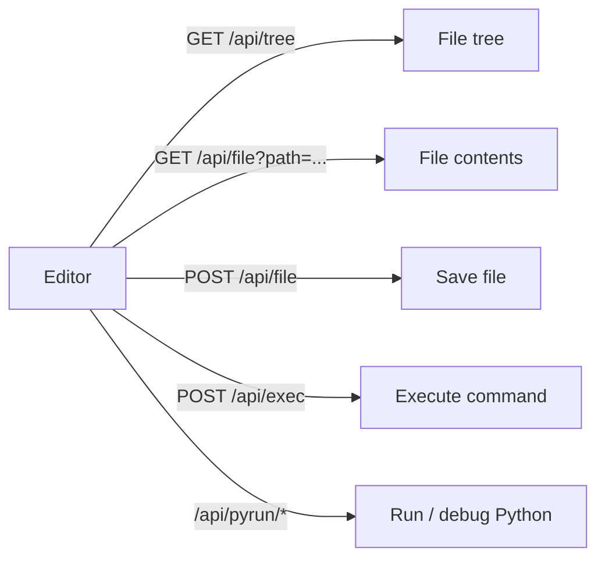

# SystemMngmntService — manual and technical reference

Installation, configuration, every page and tool in detail, the HTTP API, project layout and development notes.
For what the project is and what it looks like, see the [README](../README.md).

## Contents

- [Features at a glance](#features-at-a-glance)
- [Quick start](#quick-start)
- [Project Structure](#project-structure)
- [Configuration (`config.json`)](#configuration-configjson)
- [Main Flow](#main-flow)
- [Routes](#routes)
- [API](#api)
- [System monitor](#system-monitor)
- [HW Utils popup](#hw-utils-popup)
- [Test log viewer (`/logs`)](#test-log-viewer-logs)
- [Git (Settings → Git, Git icon in the editor and docs)](#git-settings--git-git-icon-in-the-editor-and-docs)
- [Documentation (`/help`)](#documentation-help)
- [Test Platform (`/tests`)](#test-platform-tests)
- [Device display (Settings → Display)](#device-display-settings--display)
- [Video (Settings → Video)](#video-settings--video)
- [UI designer (`/ui`)](#ui-designer-ui)
- [Installation](#installation)
- [Testing](#testing)
- [Authentication](#authentication)

## Features at a glance

| | |
|---|---|
| **Service control** | status / start / stop / restart of the target service and any other systemd unit |
| **System monitor** | CPU, RAM, temperature, active network interface and block devices with live charts; on the main page and as a floating, resizable, semi-transparent window on every other page |
| **Backups & deploy** | archive the project, upload a `.tar.gz`, deploy it with an automatic backup |
| **Code editor** | file tree (new file / folder in any folder: hover a folder, or the toolbar buttons for the folder clicked last), Monaco editor with outline, **run / debug Python** (breakpoints, step over / into / out, variables, hover values), service log, **interactive terminal** (a real shell: mc, htop, nano, vim), command macros |
| **Test platform** | run `*_test.py` fixture sequences, live PASS/FAIL table, operator prompts, stop-on-fail, a log per run, yield statistics |
| **Log viewer** | filter runs by script / verdict / serial / date, yield and first-pass yield, top failing steps, parsed log view, per-step value analysis (Cpk), CSV export |
| **Docs** | Markdown knowledge base in `help/`: sidebar tree, full-text search, rendered view with table of contents and code copy buttons, Monaco editor with live preview, toolbar, image paste/drop upload, attachments; **diagram editor** for pinouts and block diagrams (exported to SVG, embedded in pages) |
| **Git** | Settings → Git and a Git popup in the code editor and docs: changes with diff, commit (selected files, current or new branch, push after), branches, fetch / pull / push, problem detection with one-click fixes, discard / reset to remote with automatic backup; HTTPS token stored outside the repositories |
| **HW Utils** | logical device list, `/dev` tree, USB/PCI/I²C buses (`lsusb` / `lspci`), network interfaces and **CAN bus** (bitrate, RX trace, TX with repeat timer), **GPIO** viewer and manual control, **I²C** scan + register read/write, **udev** events / rules editor / tools, **Modbus** master (RTU / TCP / UDP, macros, timers, scan, sessions), **Terminal** (serial / TCP / UDP, JSON plot), **Clone / Image** of the system (to a disk or an SMB share) |
| **Video** | preview of V4L2 cameras |
| **Per-host config** | one repository deployed to several machines, each with its own section in `config.json` |
| **Simple access model** | anonymous operators see the target service (restart) and the read-only monitor — or, as a test machine, the Tests page; archives (download) and docs (read only) can be opened; everything else needs a login |

---

## Quick start

```bash
git clone <this repo> && cd SystemMngmntService
sudo ./install.sh           # menu: install dependencies (online/offline), register and start the service
```

Open `http://<device>/`, log in (default `admin` / `admin` — change it in **Settings**) and set the target
service, project and backup directories. See [Installation](#installation) and [Configuration](#configuration-configjson).

### Navigation

The top bar has the work **sections** on the left — **Main**, **Code** (editor), **Docs** (viewer, editor,
diagrams), **Tests** (sub-pages **Run** and **Logs**, shown while the section is open) — and the global tools on the
right: **Video**, **Monitor**, **HW Utils**, **Services**, **Settings** (gear), the **Power** menu (restart the panel service, reboot, shutdown,
logout). When the panel's git upstream has new commits (checked every `update_check_minutes` while the panel is
open, only if there is internet), a yellow **⚠** button appears after the power menu: its popup lists the commits,
updates the panel (`git pull --ff-only`, local changes are kept) and restarts it.

---

## Project Structure

```
SystemMngmntService/
├── app.py            # Entry point: creates the Flask app and registers blueprints
├── config.json       # Configuration (paths, port, service, authentication)
├── macros.json       # Code editor command macros
├── core/             # Shared backend: config, auth, shell helpers, navigation, template context
├── routes/           # One Flask blueprint per feature (dashboard, services, backups, editor, ...)
├── templates/
│   ├── base.html     # Common layout: top bar, shared modals and scripts
│   ├── partials/     # Reusable fragments (services modal, video, power menu, update button, flash)
│   ├── index.html    # Main dashboard
│   ├── editor.html   # Code editor
│   ├── settings.html # Settings page
│   └── login.html    # Login page
├── static/
│   ├── css/          # base.css + components.css (shared), <page>.css
│   ├── vendor/       # Font Awesome, Monaco, xterm.js served locally (offline), see vendor/README.md
│   ├── js/           # core.js, services.js, sysinfo.js, monitor.js, video.js, power.js, devices*.js (shared), <page>.js
│   └── img/
├── help/            # Documentation (Markdown), help/img images, help/docs attachments, help/examples raw notes
├── UI/               # Device display: Kivy scripts shown on the board's screen (Settings → Display), smms_ui.py
│                     #   helper, images/ pictures, backgrounds/ (Settings → Display → Background);
│                     #   .kivy/ and .run/ are git-ignored runtime files
├── testPlatform/     # Test platform: *_test.py sequences, testStrategy.py / testWatch.py (run from the Tests page)
│   └── instruments/  # Drivers, file = instrument model: psu_custom6020, psu_custom305, siglent_spd1305x,
│                     #   siglent_sdg1032x, siglent_sdl1020x, rigol_dho804/924, owon_xdm, owon_oel, fs9922, ads1115,
│                     #   stlink_stm8; protocols / tools: modbus, scpi, serial_term, ssh_term, param_file, uut_serial;
│                     #   fw/ = firmware, binaries
├── testLogs/         # One log file per test run (git-ignored)
├── tests/            # Unit/integration tests (unittest) + dev server and screenshot helpers
├── docs/             # MANUAL.md (this file), img/ README screenshots (tests/docs_screenshots.sh)
├── CLAUDE.md         # Development rules (for humans and AI assistants)
├── install.sh        # Installer: menu, online/offline install, offline bundles, systemd unit
├── tools/            # offline_bundle.py — builds offline bundles (used by install.sh bundle)
└── setup.sh, setup_offline.sh  # Old entry points, call install.sh online / offline
```

See `CLAUDE.md` for how to add pages and API endpoints.

---

## Configuration (`config.base.json` + `config.json`)

Two files: **`config.base.json`** (in git) holds `default` — shared defaults for every machine, edited by hand and
committed; **`config.json`** (git-ignored, written by the panel) holds this machine's own settings, passwords and
camera logins and never goes into git. The effective config is built-in ← base `default` ← local `default` ←
local `hosts[<hostname>]`. A fresh clone without `config.json` runs on the base defaults; the first save creates it.
`config.json`:

```json
{
    "default": { "target_dir": "...", "service_name": "...", "auth": { ... } },
    "hosts": {
        "orangepi3b": { "device_name": "NAS", "target_dir": "...", ... }
    }
}
```

- The machine is identified by its hostname.
- A host without its own section uses `default` (missing keys fall back to built-in defaults).
- Saving on the Settings page stores the settings in the section of the current host; from then on that host
  uses its own values. "Reset to defaults" on the Settings page removes the section.
- An old flat `config.json` is converted automatically on first start.

Fields (same in `default` and in a host section):

| Field | Description |
|---|---|
| `target_dir` | Target application directory |
| `backup_dir` | Directory for archive storage |
| `service_name` | Name of the systemd service to monitor (`none` = no target service) |
| `backup_skip` | Patterns left out of project archives (Settings → Backups, syntax below) |
| `deploy_keep` | Patterns of the current project copied into a deployed one (configs, data); default none — everything else is replaced |
| `backup_stop_service` | Stop the target service (if running) while an archive is written (default `true`) |
| `host` / `port` | Panel listen address |
| `auth.enabled` | Enable / disable login |
| `auth.username` / `auth.password` | Credentials |
| `public_service_actions` | Service actions allowed without login (default `["restart"]`) |
| `public` | Without login: `{home: "dashboard"\|"tests", backups: bool, docs: bool}` (Settings → Access) |
| `tests_dir` / `test_logs_dir` | Test scripts / run logs (relative to the project) |
| `help_dir` | Documentation folder (default `help`, relative to the project) |
| `update_check_minutes` | How often the panel checks its git upstream for updates while open (default 60, `0` = off) |
| `show_demo_tests` | List the `demo*` test scripts (default true; off = hidden everywhere and not startable) |
| `video_sources` | Network cameras with logins (Settings → Video; kept in the local file only) |

---

## Main Flow



---

## Routes

### Dashboard (`/`)



### Backup and Deploy

Both run as **one background job** (`core/backups.py`) with a progress bar, log and *Cancel* in the *Backup* card;
the page polls `/api/backups/job`. While a job runs a second one is refused, and the archive it reads or writes
cannot be downloaded, deployed or deleted. An archive is written as `<name>.partial` and renamed when complete —
unfinished files are never listed.

**Patterns** (Settings → Backups; one per line, `#` = comment, relative to the project directory; a matching folder
is taken as a whole):

| Pattern | Matches |
|---|---|
| `.git/` | folder `.git` at any depth (trailing `/` = folders only) |
| `flash.bin` | file or folder of that name at any depth |
| `*.log` | by mask at any depth |
| `logs/*` | everything inside `logs` of the project root (the empty folder stays); a `/` inside anchors to the root, `*` also crosses sub-folders |
| `/notes.txt` | leading `/` anchors a single name to the project root |

The backup directory and the panel itself (when inside the project) and other mounted filesystems are never archived.
*Check* on the settings page (`/api/backups/preview`) lists what the unsaved patterns match; *Pick from the project…*
opens a tree of the project where every row adds / removes `/path` (a folder: `/path/`) or `*.ext` in the Skip / Keep list.

```mermaid
sequenceDiagram
    participant User
    participant Job as Panel job
    participant Service as Target service
    participant FS as File system

    User->>Job: POST /api/backups/create
    Job->>Service: stop (only if running and backup_stop_service)
    Job->>FS: <project>_<ts>.tar.gz.partial → rename
    Job->>Service: start (only if it was running)

    User->>Job: POST /api/backups/deploy {filename, backup}
    Job->>FS: optional full backup <project>_pre_deploy_<ts>.tar.gz (no skip patterns, .git included)
    Job->>FS: extract into .<project>.deploy-<ts> (project untouched; failure = staging deleted)
    Job->>Service: stop (only if running)
    Job->>FS: copy deploy_keep matches from the project into the new tree
    Job->>FS: rename project → .<project>.old-<ts>, new tree → project
    Job->>Service: start (only if it was running)
    Job->>FS: delete the old tree
```

- An archive with a single top folder deploys that folder's contents; otherwise its top level becomes the project.
- Unsafe members (absolute paths, `..`, paths through an archived symlink, devices) fail the deploy before anything
  changes. Running as root, the new files get the owner of the old project folder; kept files keep their owner.
- Refused targets: `/`, system folders, home directories, mount points, a project that contains the backup
  directory or the panel itself.
- The target service is never stopped when it is the panel's own unit.

### Code Editor (`/editor`)



**Terminal.** The *Terminal* tab of the bottom panel is a real shell in a pseudo-terminal, like PuTTY / SSH:
full-screen programs (mc, htop, nano, vim, less), colours, the mouse and F-keys work, the window size follows the
panel (⤢ maximizes it). It runs as the owner of `target_dir`, starting in `target_dir`. Copy: select with the
mouse, then Ctrl+Shift+C (or Ctrl+C while text is selected); paste: Ctrl+V / Ctrl+Shift+V. A page reload
reattaches to the same shell (it is closed 60 s after the last page left); **+** starts a new one. Command macros
are typed into this shell. The output of scripts started with ▶ Run / 🐞 Debug goes to the *Run* tab (keys typed
there go to the script).

**Documentation window.** The **?** button in the editor's top bar opens the documentation in a floating
window (drag the title, resize from the corner): sections → documents → headings on the left with a search over
titles, headings and text, the page on the right in a compact layout. Every line of a code example has *Insert*
(at the editor cursor, indented like the current line) and *Copy* buttons on hover, every block has *Insert* /
*Copy* in its header; a click on `inline code` copies it. It opens on [Test platform](../help/testing/test-platform.md).

**Run / debug Python.** The buttons in the tab bar run the open `.py` file (▶, Ctrl+F5) or debug it
(🐞 / Continue F5, Pause F6, Step over F10, Step into F11, Step out Shift+F11, ↶ run the previous line again F7,
Stop Shift+F5). ↶ and *Set next line here* (editor context menu) move the execution point like pdb `jump` —
variables are not undone. Breakpoints: click
left of a line number or F9 (kept per browser). The script runs in a pseudo-terminal — exactly as in an SSH
console — its output appears in the **Terminal** tab and lines typed there go to its stdin (Ctrl+C interrupts).
While paused the line is highlighted and the side panel's **Debug** tab shows the variables (expandable), the
call stack (click a frame), an *Evaluate* box, breakpoints, arguments for the script (e.g. `--sn 12345`, remembered
per file) and *Stop at the first line*; hovering a name in the editor shows its value. Stepping stays in your code
(files under `target_dir`), an uncaught exception pauses where it was raised. Stop quits at the current line, so
`finally` blocks — a test's `finalize` — still run. One session at a time; closing the page stops it, and a
test cannot start on the Tests page while it runs (and vice versa). Starting releases GPIO lines held by the popup.

---

## API

| Method | Route | Access | Description |
|---|---|---|---|
| GET | `/`, `/main` | public | Info panel; with `public.home = tests` `/` sends anonymous visitors to `/tests` (`/main` stays the info panel) |
| GET | `/api/services` | public | systemd services (JSON); anonymous: only the target service |
| GET | `/api/status?name=` | public | `systemctl status` output; anonymous: target service only |
| POST | `/api/service/<start\|stop\|restart>?name=` | public for `public_service_actions`, else login | Service action |
| GET | `/api/sysinfo` | login | CPU, RAM, network, disks (JSON; editor side panel) |
| GET | `/api/monitor?since=` | public | System monitor: current CPU/RAM/temperature/active interface/disk I/O, block devices, chart history newer than `since`; logged in: `job` = running clone / image job (no log) or null |
| POST | `/api/power/<reboot\|poweroff>` | login | Reboot / shut down |
| GET | `/api/backups` | login, or public with `public.backups` | `{archives [{name, size, mtime, busy}], job, deploy_block, target, keep, service}` |
| GET | `/api/backups/job` | login, or public with `public.backups` | Current / last backup job: state, phase, done / total bytes, log, result |
| POST | `/api/backups/create` | login | Start a backup job → `{job}`; 409 while a job runs |
| POST | `/api/backups/cancel` | login | Cancel the job (not while the folders are being swapped) |
| POST | `/api/backups/tree` | login | `{path, skip, keep}` → one project folder with the skip / keep pattern of each entry (Settings → Backups → *Pick from the project…*) |
| POST | `/api/backups/preview` | login | `{skip, keep}` → what the patterns match in the project directory |
| POST | `/backups/upload` | login | Upload archive (multipart form) |
| GET | `/backups/download/<name>` | login, or public with `public.backups` | Download archive |
| POST | `/api/backups/deploy` | login | `{filename, backup}` → start a deploy job (replaces the project directory) |
| POST | `/api/backups/delete` | login | Delete archive (409 while the job uses it) |
| GET | `/api/tree[?path=]` | login | One folder of the target directory (the editor loads folders when they are opened) |
| GET/POST | `/api/file` | login | Read / write file |
| POST | `/api/file_create`, `/api/file_rename`, `/api/file_delete` | login | File operations; `file_create` {dir, name, kind: file / dir} — a new `*_test.py` gets a test script skeleton, new entries belong to the folder's owner |
| GET | `/api/file_raw` | login | Raw file (image preview) |
| POST | `/api/exec` | login | Execute shell command |
| POST | `/api/term/open` | login | Start a shell in a pty `{cols, rows}` or reattach `{id}` → `{id, user, offset}` |
| GET | `/api/term/stream?id=&from=` | login | Shell output as Server-Sent Events (`out` {d, o}, `exit` {code}) from byte offset `from` |
| POST | `/api/term/input`, `/api/term/resize`, `/api/term/close` | login | Keys `{id, data}` / window size `{id, cols, rows}` / end the shell |
| POST | `/api/pyrun/start` | login | Run / debug a `.py` in target_dir `{path, args, debug, breaks, stop_on_entry}` |
| GET | `/api/pyrun/poll?id=&since=` | login | Session state, new terminal output, pause info (keeps the session alive) |
| POST | `/api/pyrun/cmd`, `/input`, `/stop` | login | `{id, action: continue/next/step/return/pause/frame}` / stdin text / stop |
| POST | `/api/pyrun/eval`, `/vars`, `/breaks` | login | Evaluate while paused (`hover` = names only), variable children, update breakpoints |
| GET/POST | `/api/macros` | login | Editor command macros |
| GET | `/api/video_devices`, `/api/video_resolutions`, `/api/video_feed` | login | Video streaming |
| POST | `/api/video_stop` | login | Stop video stream |
| GET | `/api/browse` | login | Browse directories (settings path picker) |
| GET | `/api/devices/dev` | login | `/dev` tree (type, maj:min, mode, owner, symlink target) |
| GET | `/api/devices/dev/info?path=\|devpath=` | login | `udevadm info` properties of a node in `/dev` or a `/devices/...` path |
| GET | `/api/devices/list` | login | Device nodes from the udev database, grouped by kind |
| GET | `/api/devices/buses` | login | USB topology, PCI devices, I²C adapters and clients |
| GET | `/api/i2c/buses` | login | I²C adapters with kernel clients, saved labels, address hints (no bus access) |
| POST | `/api/i2c/scan`, `/api/i2c/read`, `/api/i2c/write` | login | `{bus, mode}` / `{bus, addr, reg, width, length, force}` / `{bus, addr, reg, width, data, force}` |
| POST | `/api/i2c/label` | login | Name a device `{bus, addr, label}` (empty removes it) |
| GET | `/api/modbus/info` | login | Serial ports, saved profiles, functions, whether serial is locked by a test |
| GET | `/api/modbus/sessions`, `/api/modbus/session?name=` | login | Saved sessions / one session (profile, results, log, scan hits, notes) |
| POST | `/api/modbus/session/save`, `/api/modbus/session/delete` | login | `{name, data, overwrite}` (409 if it exists) / `{name}` |
| POST | `/api/modbus/request`, `/api/modbus/scan`, `/api/modbus/profiles` | login | `{conn, ops: [{unit, fn, addr, count \| values}]}` / `{conn, first, last, fn, addr, timeout}` (≤ 64 ids) / `{profiles, current}` |
| GET | `/api/tty/info`, `/api/tty/read?id=&since=` | login | Ports, open connections, profiles / chunks received or sent since a number (base64) + state |
| POST | `/api/tty/oneshot` | login | Open → send → reply → close `{conn, text, hex, wait, timeout}` → `{chunks, ms, end}` |
| GET | `/api/tty/sessions`, `/api/tty/session?name=` | login | Saved terminal sessions / one session |
| POST | `/api/tty/session/save`, `/api/tty/session/delete` | login | `{name, data, overwrite}` / `{name}` |
| POST | `/api/tty/open`, `/api/tty/send`, `/api/tty/lines`, `/api/tty/close`, `/api/tty/profiles` | login | `{conn}` / `{id, text, hex}` or `{id, b64}` / `{id, dtr, rts}` / `{id}` / `{profiles, current}` |
| GET | `/api/sysclone/info`, `/api/sysclone/job?since=` | login | Disks, used size / minimal partition, u-boot, share state, current job / its log from line `since` |
| POST | `/api/sysclone/clone`, `/api/sysclone/image`, `/api/sysclone/stop` | login | `{disk, confirm, extra_mb, whole, grow}` / `{folder, extra_mb, tag, compress, grow}` / — |
| GET | `/api/sysclone/roots`, `/api/sysclone/browse?root=&path=`, `/api/sysclone/find?root=&path=` | login | Image locations (share, mounted non-system disks, homes) / folders + images of a folder / images below it |
| POST | `/api/sysclone/write` | login | Write an image to a disk `{root, path, disk, confirm}` |
| GET | `/api/smb/list?path=` | login | Folder of the mounted share (symlinks shown, never followed out of it) |
| POST | `/api/smb/mount`, `/api/smb/umount`, `/api/smb/forget`, `/api/smb/mkdir` | login | `{share, username, password, vers, remember}` / — / forget the saved password / `{path, name}` |
| GET | `/api/devices/usb/verbose[?bus=&dev=]` | login | `lsusb -v -s bus:dev`, or `lsusb` + `lsusb -t` |
| GET | `/api/devices/gpio` | login | GPIO chips and lines like `gpioinfo` (read-only, libgpiod v1/v2) |
| GET | `/api/devices/gpio/ctl?client=` | login | Lines held by a popup client with live values (also renews its lease) |
| POST | `/api/devices/gpio/ctl` | login | `{client, action: claim\|input\|output\|set\|release\|release_all, chip, offset, value}` |
| GET | `/api/netcfg` | login | Settings → Network: Ethernet / Wi-Fi devices, NetworkManager connections, Wi-Fi radio, the interface this visitor comes through, pending change |
| GET | `/api/netcfg/connection?uuid=`, `/api/netcfg/wifi?ifname=&rescan=1`, `/api/netcfg/pending` | login | One connection (no secrets) / Wi-Fi scan / pending change |
| POST | `/api/netcfg/connection` | login | Change a connection `{uuid, name, interface, autoconnect, priority, ipv4 {method, addresses, gateway, dns, ignore_auto_dns}, ipv6 {method}, wifi {hidden}, password}` (an active one is re-applied) |
| POST | `/api/netcfg/activate`, `/deactivate`, `/delete`, `/radio`, `/join`, `/hotspot` | login | `{uuid}` / `{on}` / `{ssid, password, ifname, security, hidden}` / `{ssid, password, ifname}`; each answer is the pending change |
| POST | `/api/netcfg/confirm`, `/api/netcfg/revert` | login | Keep / roll back the pending change (NetworkManager checkpoint) |
| GET | `/api/net/interfaces` | login | Interfaces (state, addresses, counters, CAN bit timing), routes, DNS |
| POST | `/api/net/can/link` | login | `{iface, action: open\|close, bitrate, sample_point, restart_ms, listen_only}` |
| GET | `/api/net/can/frames?iface=&since=` | login | New CAN frames + cyclic jobs; polling keeps the socket open |
| POST | `/api/net/can/send` | login | `{iface, action: send\|cyclic\|stop\|stop_all\|clear, id, ext, rtr, data, period_ms, job}` |
| GET | `/api/udev/status` | login | systemd-udevd state, udev version, rules counts, subsystems |
| POST | `/api/udev/action` | login | `{action: reload\|restart\|trigger\|test\|attrs, kind, subsystem, device, devpath, all}` |
| GET | `/api/udev/events?since=` | login | New monitor events; polling keeps `udevadm monitor` running |
| POST | `/api/udev/events/clear` | login | Clear the event buffer |
| GET | `/api/udev/rules` | login | Rules files of `/etc`, `/run`, `/lib` with override info |
| GET | `/api/udev/rule?dir=&name=` | login | Read one rules file |
| POST | `/api/udev/rule` | login | Save `{name, text, force}` to `/etc/udev/rules.d` (422 on syntax problems unless `force`) |
| POST | `/api/udev/rule/check` | login | Syntax check `{text}` → `{problems: [{line, message}]}` |
| POST | `/api/udev/rule/delete` | login | Delete `{name}` from `/etc/udev/rules.d` |
| POST | `/api/settings` | login | Save settings |
| GET | `/api/tests/scripts` | login, or public with `public.home = tests` | Test scripts (`*_test.py` in `tests_dir`) |
| POST | `/api/tests/start` / `/api/tests/stop` | login, or public with `public.home = tests` | Start `{script, serial, stop_on_fail}` / stop the running one |
| GET | `/api/tests/status?run_id=&results_from=&output_from=` | login, or public with `public.home = tests` | Current run, incremental results, output and pending operator prompt |
| POST | `/api/tests/answer` | login, or public with `public.home = tests` | Answer the pending operator prompt `{run_id, prompt_id, value}` |
| GET | `/api/tests/logs`, `/api/tests/logs/<name>[?download=1]` | login, or public with `public.home = tests` | Run history / log file |
| POST | `/api/tests/logs/delete` | login | Delete `{name}` or `{all: true}` |
| GET | `/logs` | login, or public with `public.home = tests` | Test log viewer page |
| GET | `/api/logs?script&verdict&q&from&to&step&offset&limit` | login, or public with `public.home = tests` | Filtered runs (newest first) + statistics (yield, first-pass yield, top failing steps) |
| GET | `/api/logs/view/<name>` | login, or public with `public.home = tests` | One log parsed into header, steps, sections, output, operator Q/A, footer |
| GET | `/api/logs/step?name=&…filters` | login, or public with `public.home = tests` | One step across the filtered runs: values, min/mean/max/σ, Cpk |
| GET | `/api/logs/export.csv?…filters` | login, or public with `public.home = tests` | Filtered runs as CSV (one row per run) |
| GET | `/api/tests/stats?script=` | login, or public with `public.home = tests` | Board counts per verdict for a script |
| GET | `/api/git/repos`, `/api/git/status?repo=`, `/api/git/summary?repo=`, `/api/git/diff?repo=&path=` | login | Repositories (project, panel, docs), full status + problems, badge counts, diff of a changed file |
| POST | `/api/git/commit`, `/branch`, `/checkout`, `/branch_delete`, `/fetch`, `/pull`, `/push`, `/discard`, `/reset`, `/fix`, `/identity` | login | Git actions `{repo, …}`; every answer carries the new status |
| GET | `/api/git/tree_status` | login | Changed files of target_dir's repositories (editor tree marks) |
| POST | `/api/git/clone`, `/api/git/init` | login | Clone `{url, name}` into target_dir / initialize target_dir |
| GET / POST | `/api/git/credentials` | login | HTTPS username + token (write-only: only `token_set` / last 4 chars come back) |
| GET | `/api/update/status[?force=1]` | login | Panel update check: commits the panel repo is behind its upstream (fetch runs in the background) |
| POST | `/api/update/apply`, `/api/update/restart` | login | `git pull --ff-only` of the panel / restart the panel's own systemd unit |
| GET | `/api/display/backgrounds`, `/api/display/background/<name>` | login | Pictures of `UI/backgrounds/` / one picture (preview) |
| GET | `/api/display/status`, `/api/display/scripts` | login | Device display: process state, settings, Kivy / X detection, log / scripts of `UI/` with their docstrings |
| POST | `/api/display/settings`, `/api/display/restart` | login | Save the display settings (applied at once: the script is replaced / stopped) / restart the script |
| POST | `/api/update/plan`, `/api/update/force` | login | Git panel → *Update panel*: fetch and list local changes in the way / update to the upstream whatever is local (`{confirm: true}` when the plan has issues; saved first: backup branch, git stash, copies in `.git/panel-update-backup/`; `config.json` kept), then restart the unit → 409 `{error, plan}` without confirmation |
| GET | `/help[?doc=<path>]` | login, or public with `public.docs` (read only) | Documentation viewer / editor |
| GET | `/help/file/<path>[?dl=1]` | login, or public with `public.docs` | Image, attachment or raw page from `help_dir` (sandboxed) |
| GET | `/api/help/tree` | login, or public with `public.docs` | All pages `{path, title, mtime, size}` |
| GET / POST | `/api/help/doc` | GET: login or `public.docs`; POST: login | Read `?path=` / save `{path, content, mtime, force}` (409 if changed since `mtime`) |
| POST | `/api/help/create`, `/api/help/rename`, `/api/help/delete` | login | `{path, title}` / `{path, new_path}` (fixes img/docs links) / `{path}` (moved to `.trash/`) |
| GET | `/api/help/search?q=` | login, or public with `public.docs` | Pages containing every word, with matching lines |
| GET | `/api/help/assets?kind=img\|docs` | login | Images / attachments with the pages that use them |
| POST | `/api/help/upload` | login | Multipart `kind` + `file`(s); returns the stored names |
| POST | `/api/help/asset_delete` | login | `{kind, name}` (moved to `.trash/`) |
| GET | `/api/help/diagrams`, `/api/help/diagram?name=` | login | Diagram list (with `component` info of library components) / one diagram model with the pages that embed it (`used_by`) and the diagrams that place it as a unit (`used_in`) |
| POST | `/api/help/diagram/create`, `/save`, `/rename`, `/delete` | login | `{name, data, svg}` / `{name, data, svg, mtime, force}` (409 on conflict) / `{name, new_name}` (fixes page links and unit `ref`s) / `{name}` |

---

## System monitor

The **System Monitor** card on the main page is public (read-only, also for anonymous visitors); for
logged-in users the **Monitor** button in the top bar of every other page opens the same view in a floating window (drag by the title bar, resize from the
bottom-right corner, opacity slider, ×). Position, size, opacity and the open state are remembered in the
browser, so the window stays open while moving between pages.

- Tiles: CPU % (per-core bars, frequency, load average), RAM, swap, temperature (all thermal zones, CPU first),
  active network interface rates, uptime / processes.
- Charts (1 / 5 / 15 min window, hover for values): CPU %, RAM %, network RX/TX of the active interface.
- Block devices (`lsblk`, loop/ram skipped): size, model/transport, NVMe temperature, filesystem/swap usage,
  mount points, read/write rate and busy %.
- Active interface = the default route with the lowest metric (otherwise the first link that is up):
  state, carrier, speed, addresses, gateway, MAC/MTU, totals, errors/drops.

`core/monitor.py` samples `/proc` and `/sys` once per second and keeps 15 minutes of history. The sampler
runs only while the page polls `/api/monitor` (30 s lease); the browser polls every 2 s and pauses in a hidden tab.

---

## HW Utils popup

The **HW Utils** button in the top bar (logged in) opens a popup with ten tabs. With *Auto* on, the
current view refreshes every 2–3 s; new devices are highlighted, added/removed ones are listed in the
footer (plus a toast, except `/dev/pts`, `/dev/shm`). All groups, trees, chips, bus sections and rules
directories start collapsed (a filter expands what matches; *Expand* / *Collapse* buttons). Clicking a device opens a side panel with its udev
properties and actions: *Attributes* (`udevadm info -a`), *Test rules* (`udevadm test`, dry run),
*Trigger change*, *New rule…* (drafts a rule matching the device and opens it in the rules editor).

- **Devices** — the udev database grouped by kind: serial ports, USB, video, I²C, SPI, GPIO, storage,
  input, sound, network, display, other, virtual (hidden by default). Human names (hwdb vendor/model,
  V4L product, disk model/size/filesystem), driver, VID:PID, symlinks.
- **/dev** — the device node tree (symlinks are not followed) with a group and a text filter.
- **Buses** — USB topology like `lsusb -t` (VID:PID, hwdb names, serial, speed, interface class → driver,
  device nodes of each device; 🔍 = `lsusb -v`), PCI (`lspci -k`), I²C adapters with the clients the kernel
  knows about (the bus is never scanned).
- **Network**
  - *Interfaces* — every interface with type, state, IPv4/IPv6, MAC, RX/TX rate and errors; a row expands to
    MTU, driver, link speed, packet counters (and bit timing / bus state / error counters for CAN).
    *Routes & DNS* below. Read-only: interfaces other than CAN are never reconfigured.
  - *CAN bus* — SocketCAN tool for `can*` / `vcan*`: *Open* applies bitrate, sample point, restart-ms,
    listen-only (`ip link set … type can …`, root) and brings the link up, *Close* brings it down (vcan: up/down
    only). Frames (RX, own TX, error frames with decoded class) in *Trace* or *By ID* (count, period, changed
    bytes highlighted). Send a frame (hex ID, Ext, RTR, hex data) or *Start repeat* every N ms; running
    repeats are listed with counters and a Stop button. The socket and all repeats exist only while the
    CAN view is open (leaving it stops the repeats, an idle client loses them after 10 s). Configuration is
    locked while a test script runs; starting a test stops all repeats.
- **GPIO** — every `/dev/gpiochip*` with its lines: offset, global sysfs number (`base + offset`), name,
  consumer, direction, active level, bias/drive flags. Without the Python `gpiod` module the raw
  `gpioinfo` output is shown.
  *Claim* requests a free line "as is" (its state is not changed), then it can be switched IN/OUT, an output
  toggled 0/1, an input level is read every second. Lines are held only while the GPIO tab is open:
  switching the tab, closing the popup or the page releases them, and a client that stops polling loses
  them after 6 s (`core/gpio_ctl.py`, `LEASE_SECONDS`). Claiming is refused while a test script runs, and
  starting a test releases every web-held line.
- **I²C** — `i2cdetect`-style grid of a bus (pick `i2c-N`): *Scan* probes addresses 0x03–0x77 (auto / quick
  write / read byte) — only when pressed, never on its own. Cells: green = answers and has a name (kernel client
  or your label), orange = answers, unknown (with a "maybe: …" hint of typical chips), blue `UU` = bound to a
  kernel driver, dashed red = declared in the device tree / labelled but no answer. Click an address: *Read*
  `Len` bytes from a register (8-bit, 16-bit or no register address — `i2ctransfer` with repeated start;
  hex dump + u16/s16/u32 values), *Write* hex bytes (`C3,83`, `0xc3 0x83`). Driver-bound addresses need *Force*.
  ✎ names a device (stored per host in `config.json` → `i2c_labels`). All transactions are logged on the right.
  Locked while a test script runs.
- **udev**
  - *Events* — live `udevadm monitor --kernel --udev --property` (filter by source, text; pause; click an
    event for its properties). The monitor process runs only while this view is polled and stops 10 s
    later (`core/udev.py`, `UdevMonitor`).
  - *Rules* — rules files of `/etc/udev/rules.d` (editable), `/run/udev/rules.d` and `/lib/udev/rules.d`
    (read-only, *Override in /etc* copies one into `/etc`). Overridden files are marked. *Check* runs a
    built-in syntax check (`udevadm verify` needs systemd ≥ 254); Save asks before writing a file with
    problems. Changes apply after *Reload rules*.
  - *Service & tools* — `systemd-udevd` status, restart, reload rules, `udevadm trigger` (by subsystem
    and/or device), `udevadm test`, attribute walk.
- **Modbus** — master for Modbus RTU on a serial port (USB-RS485, UART), RTU frames over TCP / UDP (transparent
  serial servers such as ebyte / USR) and Modbus TCP / UDP devices (`core/modbus.py`, stdlib + pyserial). A table of
  request rows ("macros": name, unit, function 01–06 / 15 / 16, 0-based address, count or values, format u16 / s16 /
  hex / binary / ascii / u32 / s32 / float32 with word swap) in two tables: **manual requests** (set the data, run
  with ▶) and **timer rows**, each with its own period and on/off switch — *Start timers* runs them (rows that are
  due go out together, the next request only after the answer), *Stop timers* stops them; ▶ runs any row at any
  time. *Run all* runs both tables once. Timers run only while the tab is open. The TX / RX frames run full width
  on top (newest at the bottom); below them a **quick request** line (unit, function, address, count / values,
  format → *Run*, *+ Row*, *[[ ]]*). **Notes** (kept in the profile) describe registers as tags —
  `[[03 4 3 ascii]]` (read), `[[06 100 =1]]` (write), optional format and `uN` unit — shown as buttons: ⇩ fills the
  quick request, ▶ runs it; *Examples* lists the syntax. The port is opened only for each
  request batch; *Close port* stops timers / scan so it is free for other tools. *Scan* probes unit ids (an exception
  answer counts as a device; a row can be added from a hit). TX / RX frames in hex on the right. Profiles
  (connection + rows + period) are saved per host in `config.json` → `modbus`, exported / imported as JSON.
  *Session* → *Save* stores the whole research state under a name — connection, rows, last results, frame log, scan
  hits and notes — as a JSON file in `modbusSessions/` (git-ignored, `modbus_sessions_dir`); pick it in the list to
  continue later. Serial ports are locked while a test script runs.
- **Terminal** — raw data terminal for a serial port, a TCP client or UDP (send to host:port and / or listen on a
  port — empty = a free port chosen automatically; datagrams show their sender) in one tool (`core/ttyterm.py`).
  Received data as text lines (`\r\n`, `\n`, `\r`; long lines scroll sideways, *wrap* optional; control bytes and
  bytes that are not UTF-8 shown as `\xNN`, saved sessions keep them exactly) or a hex dump (16 bytes per row with
  offset and ASCII, sender and size on the first row of each packet), with times; sent data in another colour. *Flood guard*: above 256 KB/s or 1000 packets/s (a video stream, the wrong
  port) data is only counted, not stored or shown, and read in small batches (cheap on the CPU) until the rate is
  back to normal; binary garbage and very long lines are folded in the view. JSON objects in the stream (one per line or spread over
  lines) get a `{}` badge (pretty view) and their numbers / booleans are collected per field path — *Plot* opens a
  popup to tick fields, one live chart per field. Send field with line ending (default: LF for serial, CR LF for TCP,
  none for UDP), `\n \r \t \0 \\ \xNN` escapes or **hex** bytes in any common notation — `01 03 0A`, `01030A`,
  `0x01,0x03`, `\x01\x03`, `01:03:0A`, `01-03-0A`, `{0x01, 0x03}`, text in quotes (`"AT" 0D 0A`); the byte count /
  an error shows next to *hex*, ticking it converts the field (text → `41 54 0D 0A`, valid hex → text), history (↑ ↓); *HTTP GET* fills a browser-like request (host,
  user agent, language). Not connected, a send is **one-shot**: open → send → wait for the reply (until the peer
  closes, 250 ms after the last byte, or the *≤ ms* timeout; *reply* off = don't wait) → close — e.g. SCPI
  instruments with one TCP connection per command. Connected (*Connect*), the connection stays open. **Macros**
  table (name, command, hex, line ending, reply, own period, timer switch, last reply) with *Start / Stop timers*;
  **Notes** (kept in the profile): commands written as `[[ADC:MEAS:EXT1:VOLT?1]]` show as buttons — ⇩ puts the
  command into the send field, ▶ sends it with the send field settings (line ending, hex, reply); *[[ ]]* appends
  the send field as such a tag; double-click or *Edit* to change the text.
  DTR / RTS for serial, pause, clear, download the log; profiles per host in `config.json` → `tty`; **sessions**
  (connection, macros, output, notes) saved as files in `ttySessions/` (git-ignored) — reopening parses the JSON
  in the output again, so the plot is back. The connection is closed by *Close*, by leaving the page, or 30 s
  after the last poll. Serial ports are opened exclusively (the Modbus tool gets "in use") and locked while a test
  script runs.
- **Clone / Image** — move the running system to another disk, or build a bootable `.img` on an SMB share
  (`tools/clone-system.sh`, `core/sysclone.py`). The new partition gets the size of the **used data** + 300 MiB
  reserve + *Extra* (default 128 MiB) — or the whole disk — so the target may be smaller than the source; files
  are copied with rsync, fstab / `armbianEnv.txt` get the new UUID, u-boot is written with Armbian's
  `write_uboot_platform` (sunxi and rockchip). The system disk and disks with mounted partitions cannot be chosen;
  a clone needs the red *all data will be destroyed* box ticked. *Image*: connect a share (`smb://server/share` — `//server/share` / `\\server\share` are converted, user, password, SMB version —
  mounted at `/mnt/smms-share` with mount(2), no cifs-utils; the password is kept only when *remember* is ticked,
  in the host credentials file outside the repository), browse it, pick a folder: the image
  `<host>[_tag]_<date>.img[.gz]` is built there on a loop device with **direct I/O** (buffered reads past 4 GiB of a
  file on a CIFS share hang for good on 32-bit kernels — 6.6 sunxi armv7 — so the image file is read / written only
  through the loop device or `dd iflag=direct`, also by *Write image*; without direct I/O on a network share the
  script refuses); *grow* lets the partition take the whole card
  at the first boot (`armbian-resize-filesystem`). The job runs on the server with a live log and rsync progress;
  *Stop* removes an unfinished image. *Write image → disk*: pick a location (the mounted share, a mounted
  non-system disk such as a local NAS, or a home folder), browse it (only folders and `.img` / `.img.gz` /
  `.img.xz` / `.img.zst` are shown) or *Find images* below the folder, choose a target disk (same rules as a
  clone, box ticked) — `tools/write-image.sh` writes it with dd (progress of the bytes read) and reads the first
  16 MiB back past the cache to compare. Needs root (the
  panel service). The three sections are collapsed until opened; the running / last job is shown above them. The
  job keeps running when the popup is closed or the page changes — the tab reattaches to its log when opened again,
  and the System Monitor (card / floating window, logged in only) shows a progress strip while it runs. Without
  output for 2 min the job lists its processes stuck in the kernel (state D, with the wait channel) — such a process
  (hung share / disk) cannot be stopped, only a reboot frees it; the watchdog also writes this into the job log.
  Before a job starts the panel checks: no process hangs in uninterruptible I/O (otherwise every disk tool would hang
  too — reboot first), loop devices left by an earlier image job are detached, and for an image the share has the
  free space and answers a 1 MiB write / read within 20 s. The scripts flush only their own device / file (no
  global `sync`) and wait for udev at most 30 s.

## Test log viewer (`/logs`)

Browses the run logs in `test_logs_dir` (`testLogs/`), written for every run started from the Tests page
(**Tests → Logs** in the top bar, or **Log viewer** on the Tests page).

- Filters: script, verdict (PASS / FAIL / ERROR / STOPPED, several at once), serial number or file name,
  date range, "failed at step". The filter is kept in the URL (`/logs#verdict=FAIL&q=SN-1`), so a view can be linked.
- Statistics over the filter: runs per verdict, yield (stopped runs excluded), distinct boards, first-pass yield
  (first finished run of each serial), top failing steps.
- Run list with first failure, 100 per page; click a serial to see every run of that board; CSV export.
- Log view: steps with status and a limit bar showing where the measured value lies between its limits,
  sections (stop-on-fail, finalization), operator prompts/answers, script output (can be hidden), raw text,
  search, ←/→ to move to the newer/older run.
- Step analysis (click a step name): every value of that step across the filtered runs, run chart with limits
  and mean, min / mean / max / σ / Cpk.

`core/test_logs.py` parses the log format of `core/test_runner.py` (fixed columns: name 40, condition 28, units)
and caches parsed files by mtime/size.

---

## Network (Settings → Network)

`core/netcfg.py` drives NetworkManager (`nmcli`): interfaces with their addresses, saved connections (edit name,
interface, auto-connect + priority, IPv4 DHCP / static / shared / disabled with addresses, gateway, DNS, IPv6 method,
Wi-Fi hidden flag and password; connect, disconnect, forget), Wi-Fi radio on / off, scan and join (also hidden
networks, WPA2 / WPA3 / open) and a hotspot (access point in shared mode, clients get 10.42.0.x).

**Safety net.** Every change runs inside a NetworkManager *checkpoint* (D-Bus `CheckpointCreate` via `busctl`, all
devices, rollback after 120 s). The page that made the change checks that it still reaches the panel a few seconds
later and then confirms (`CheckpointDestroy`); *Keep* / *Revert* buttons do it by hand. If the change cut the
connection, NetworkManager restores the previous settings by itself when the timeout ends. Changing the address of the
interface you are connected through: open the new address within the timeout (the banner links it) and press *Keep*.
A failing command rolls back at once; one change can be pending at a time.

**Secrets.** Wi-Fi passwords never appear on a command line or in an answer: new networks / hotspots are written as
keyfiles (0600) into `/etc/NetworkManager/system-connections/smms-*.nmconnection` and loaded with
`nmcli connection load`; a new password of a saved network is written into its keyfile the same way.

## Git (Settings → Git, Git icon in the editor and docs)

Works on the repositories of `target_dir` (*Project*), the panel itself and `help_dir` (*Docs*) — folders in one
worktree are shown once — plus every repository found inside `target_dir` (projects cloned from GitHub etc.,
up to 3 levels deep, id `dir:<relative path>`).

- **Code editor**: change marks in the file tree (M / U / D, a dot on folders with changes), the branch next to the
  root folder of every repository, the repository of the open file in the status bar (branch, changes, ahead/behind,
  GitHub/GitLab remote), *Commit* next to Save (opens the Git popup with that file selected), the Git icon opens
  the repository of the open file.
- Not a repository: clone a project (https / ssh / `git@host:owner/repo`; private https repos use the token) into
  `target_dir/<folder>`, or `git init`.

- Status: branch (switch from the list), ahead/behind the upstream, changed files with diff.
- Commit the selected files to the current branch or to a new one, optionally push right after.
- Branches: create & switch, switch, delete (asks before deleting an unmerged one). Fetch, pull (`--ff-only`), push
  (sets the upstream on the first push).
- **Problems** with fixes: root-owned files in `.git` (chown back), stale `index.lock`, merge / rebase in progress
  (abort), conflicts, missing user name / e-mail, detached HEAD (create a branch), no upstream, behind / diverged
  (pull rebase / merge / reset to remote), credentials inside a remote URL (strip), tracked `.secret_key` (untrack),
  the token found in tracked or staged files, credentials file inside a repository.
- Discard changes, **Reset to remote** — always creates `backup/<date>` at the old HEAD and stashes uncommitted work.
- git runs as the owner of the repository (the panel runs as root), non-interactive, with timeouts.
- **Token**: kept in `~/.config/systemmngmntservice/credentials.json` of the panel user (`/root/...` for the
  service), mode 600, outside every repository and never in `config.json`; the browser can only replace or remove
  it. Git receives it through a one-shot credential helper reading an environment variable of that one process —
  nothing is written to `.git/config` or remote URLs, and command output is scrubbed of it.

---

## Documentation (`/help`)

A Markdown knowledge base kept in `help_dir` (`help/`), **Docs** in the top bar (login only).

| Folder | Content |
|---|---|
| `help/*.md`, `help/<folder>/*.md` | pages; folders (up to 3 levels) are sections of the sidebar tree |
| `help/img/` | images (pasted / dropped into the editor are uploaded here) |
| `help/docs/` | attached files, rendered as file buttons |
| `help/diagrams/` | diagrams: `<name>.json` (model) + `<name>.svg` (written on every save) |
| `help/examples/` | raw notes, not listed |
| `help/.trash/` | deleted pages and files |

- View: rendered GitHub-flavoured Markdown (tables, task lists, `> [!NOTE]` boxes), highlighted code with a Copy
  button, table of contents with scroll tracking, image zoom, print. `?doc=<path>#<heading>` links to a section.
- Search (`/`): every word must occur; results show matching lines, the opened page highlights them.
- Edit (`E`): Monaco with live preview (editor / split / preview), formatting toolbar, `Ctrl+S` / `B` / `I` / `K`,
  paste or drop images and files to upload and link them, link to another page; saving detects concurrent changes.
- Links are relative to the page (`img/x.png`, `../docs/f.zip`, `other.md#section`), so the files also render
  in VS Code or Git. Rename/move rewrites the `img/` and `docs/` links for the new folder depth.
- Rendering uses vendored marked + DOMPurify + highlight.js; served files get a sandbox CSP.
- **Diagrams** (sidebar group *Diagrams*, `?diagram=<name>`; only inside the Docs page): SVG editor with
  chips/modules with pins on four sides ("tags" or "simple" pin style, pin kinds with legend), blocks, wires/arrows
  attached to blocks (orthogonal auto-route, bend points, labels), text and legend; grid snap, zoom/pan,
  multi-select, align, copy/paste, undo/redo. Pins are edited in a table that accepts rows pasted from Excel/CSV.
  Saving writes `<name>.json` and the exported `<name>.svg`; pages embed `../diagrams/<name>.svg` (toolbar button),
  and a diagram image in a page has an *Edit diagram* button. SVG/PNG download.
- **Test equipment library** (diagram editor): a diagram with a *symbol* (category + ports) is a library component —
  DUT, oscilloscope, generator, PSU, multimeter, programmer, interface adapter, hub / switch, isolator, IO block, computer, multiplexer, relay, controller, test jig, station
  (*New diagram → Library component* templates come with typical ports). The *Unit* tool (U) places components on
  other diagrams (designators MUX1, K2…); wires attach to ports (input, output, bidirectional, analog, test point,
  power, ground, bus, n.c.), a legend can show port types. *Bus* lines (tool S, or any wire drawn from a bus port)
  are thick double lines with an optional slash mark and width / name (`/8`, `SWD`); signal wires dropped onto a
  bus join it (junction dot) and the bus lists the signals it carries. A wire without its own colour takes the colour
  of its port type, and the port at the other end adopts it — one colour per net. Wires are drawn by dragging or
  corner by corner (clicks; `Enter` / double-click ends, `Backspace` drops a corner); a run of a selected wire is
  dragged across itself (horizontal up / down, vertical left / right) and attached ends stay put — a corner is added
  next to them. A wire started on another line (or `Ctrl`-dragged from it) is a *branch*, and a wire end dropped on
  a line joins it: a branch of the same kind (signal from a signal, bus from a bus) shows the colour, width and dash
  of the root line, editing them on a branch changes the whole line; branches can chain (loops are refused), taps
  stay on their run when the line is reshaped. Units keep a copy of the ports: when the component
  changes they are marked *outdated* and updated with one click; renaming a component relinks its units.
  The sidebar groups diagrams into catalogs: **Stations**, **Assemblies** (jigs / boards built of units),
  **Bus-level modules** (simplified symbols: one port per interface — SWD, UART, I²C…, no power),
  **UUT** (products under test — DUT symbols), **Components** (pin level, by category: oscilloscopes, generators, …) and plain **Diagrams**. The catalog is derived from the
  content or set in the diagram properties; *Duplicate* copies a diagram (e.g. a new instrument version) into any
  catalog / category. Files stay flat in `help/diagrams/`, so links and unit references never break.

---

## Test Platform (`/tests`)

- Scripts: every `*_test.py` in `tests_dir` (default `testPlatform/`); the first line of the module docstring is
  shown as the description. Demo scripts (`demo_*_test.py`) need no hardware.
- Instruments are objects from `testPlatform/instruments/`, named after the real model: power supplies
  `PSU_CUSTOM6020` / `PSU_CUSTOM305` / `SIGLENT_SPD1305X`, generator `SIGLENT_SDG1032X`, electronic load `SIGLENT_SDL1020X`, oscilloscopes `RIGOL_DHO804` / `RIGOL_DHO924`, OWON bench multimeter and
  electronic load, a low-level Modbus master (RTU / TCP / UDP), serial and SSH terminals, parameter files, and a
  base class for any other SCPI instrument. How to create them, a complete example and every function: `help/testing/instruments.md`
  (Docs page → testing → Instruments).
- A script runs as a child process (`python3 -u`, cwd = `tests_dir`, env `TEST_RUNNER=1`). Only one run at a time.
  Stdin receives one Enter and is closed, so interactive scripts run exactly one sequence.
- `testStrategy.TestStrategy` prints `@@RESULT {"name","condition","units","status"}` lines in runner mode;
  all other output is shown in the *Output* panel and written to the log.
- Verdict: `STOPPED` (Stop pressed: SIGINT, SIGKILL after 3 s), `ERROR` (any ERROR result, non-zero exit code,
  or no results), `FAIL` (any FAIL), otherwise `PASS`.
- Stop on fail + finalization: structure a script as `ts.run(steps, finalize)`. With the *Stop on fail* checkbox
  (checked by default; env `TEST_STOP_ON_FAIL=1`, or `--stop-on-fail` in a terminal) the first FAIL/ERROR skips the
  remaining steps. `finalize` (power off, relays to a safe state) always runs: after pass, fail, an exception or
  Stop (SIGINT; the runner waits 10 s before SIGKILL). Scripts without `ts.run()` are not affected.
  Separator rows (`ts.section(title)`) are shown in the results. Demo: `demo_stopfail_test.py`.
- Serial number: the *Serial number* field is passed to the script as `--sn <serial>` (letters, digits, `-_.`,
  up to 64 chars; empty = no argument). In a script: `ts.serial`. Enter in the field starts the test (barcode
  scanners); after a run the field is selected for the next unit. Demo: `demo_serial_test.py` (valid: `test`
  or `VTP-123456`).
- Logs: `test_logs_dir/<YYYYmmdd_HHMMSS>_<script>[__<serial>]_<VERDICT>.log` (`.running` while in progress).
  The *History* popup lists them (with serial) and can delete one log or all logs (the running log is kept).
- Board statistics (Test Run panel): PASS / FAIL / ERROR boards and yield for the selected script, counted from
  the logs (stopped runs excluded; clearing the history resets them). Step counters of the current run are shown
  under the results table.
- Operator input steps (`TestStrategy` methods; in a terminal they fall back to `input()`):

  | Method | Web UI | Returns |
  |---|---|---|
  | `askText(name, message, default="")` | text field (empty not accepted) | `str` |
  | `askNumber(name, message, lo=None, hi=None, units="", default=None)` | number field, range-checked | `float` |
  | `askChoice(name, message, options, default=None)` | drop-down | selected option |
  | `askButtons(name, message, buttons=("OK",))` | one button per option | pressed label |
  | `askYesNo(name, message)` | Yes / No buttons | `bool` |

  The script prints `@@PROMPT {json}` and blocks; the answer comes back as a JSON line on the pipe from
  `TEST_RUNNER_ANSWER_FD`. The answer is logged as an `INFO` step (does not affect the verdict); check it with
  the regular test methods. Demo: `demo_operator_test.py`.

## Device display (Settings → Display)

The board's own screen (HDMI, LCD with a touch panel) can show a Kivy script from `UI/` — a status display next to
the web panel. **Settings → Display**: switch it on, choose the script, output, size, rotation, scale, cursor and
input; enabling, the script and *Apply* take effect at once (the running script is stopped — SIGTERM, SIGKILL after
4 s — and the new one started); switching it off closes the script. Kivy comes with `sudo ./install.sh display`.

- **Output** `auto`: into the X server when one runs on the *X display* (`:0`; a window, or the full screen), else
  directly on the screen through DRM/KMS (`SDL_VIDEODRIVER=kmsdrm`) — e.g. after `systemctl stop lightdm` the
  script replaces the console login prompt; when it stops, the console comes back. `kmsdrm` / `x11` force one.
- **GPU check**: the tab shows the render nodes (`/dev/dri/renderD*` with their kernel driver — panfrost, lima,
  v3d …), the connected screens and, after the first start, the OpenGL renderer Kivy reported. Without a GPU
  driver, or with a software renderer (llvmpipe / softpipe), a warning says the screen will be slow (lower the
  frames / s to 10–15).
- **Background**: a picture of `UI/backgrounds/` (previews on the tab, a click applies it at once) drawn under
  every script by `smms_ui` (`Window.canvas.before`, panels become translucent), darkened by *Darken* (0–95 %);
  `none` = the plain theme colour. New pictures: copy `.png` / `.jpg` files into `UI/backgrounds/`.
- **Size** 0 × 0 = the screen's own resolution; **rotation** 0/90/180/270 (touch coordinates rotate with it);
  **scale** 0 = automatic (dp / sp × screen height / 720, 1080p → 150 %); **cursor** auto = shown when a mouse is
  connected when the script starts (on DRM/KMS SDL draws no pointer — Kivy's `cursor` module draws it); **touch screen** = Kivy reads the touch panels itself (`probesysfs` → mtdev / hidinput), **mouse** =
  the mouse through SDL (ignored while fingers touch).
- **Process**: `core/display_ui.py` — a supervisor thread of the panel service runs `python3 UI/<script>` as the
  owner of the project (with its video / render / input groups), restarts it after a crash with a growing delay
  (2, 5, 10, 30, 60 s; a minute of running resets it), keeps the last 300 lines of its output (shown on the tab).
  The script dies with the panel.
- **Data**: the scripts read the panel through its HTTP API (`SMMS_API`, header `X-SMMS-Token` with `SMMS_TOKEN` —
  accepted only from 127.0.0.1 and only while that process runs).

Scripts in `UI/` (each module docstring is the description shown in the settings):

| Script | What it shows |
|---|---|
| `system_monitor.py` | CPU, memory, temperature, network tiles; CPU / RAM and network charts (5 min); disks; a running clone / image job |
| `test_status.py` | Test platform: pick a test, START / STOP, steps (PASS / FAIL / ERROR), verdict; operator prompts answered on the screen (buttons, choice, number keypad, text with the on-screen keyboard) |
| `demo_controls.py` | Buttons, toggle, slider, a touch area that draws every finger / click (checks touch and mouse) |
| `demo_chart.py` | Splash screen (`UI/images/splash.png`, else the chosen background) and a live chart with buttons |

A new script: `UI/<name>.py` with a docstring, starting with `import smms_ui; smms_ui.setup()` before any other Kivy
import (it applies the settings to Kivy and handles SIGTERM); `smms_ui.api.get('/api/...')`, `smms_ui.poll(path,
seconds, callback)` (callback on the Kivy thread), `smms_ui.THEME`, `smms_ui.widgets()` → `Card`, `LineChart`,
`smms_ui.image('x.png')`. By hand on the board: `SDL_VIDEODRIVER=kmsdrm python3 UI/<name>.py` (console) or
`python3 UI/<name>.py` (X session); `SMMS_SHOT=/tmp/x.png SMMS_SHOT_DELAY=5` saves the screen and quits.
Development without the service: `python3 tests/devserver.py --display` runs the supervisor (port 5099).

## Video (Settings → Video)

- **Video devices**: every local `/dev/video*` and network camera with *Preview*. The **Video** menu of the top bar
  lists the same devices (network cameras as `<name> (network, host)`).
- **Network cameras**: RTSP / HTTP streams (name, URL, user, password, transport tcp / udp) kept only in this host's
  local `config.json` (`video_sources`, not in git). A URL pasted with `user:password@` is split; the password is
  never returned to the browser (empty field = keep it) and is removed from every message. *Test* opens the stream
  with ffprobe (≈ 12 s at most) and shows codec and size. A source is `net:<name>` everywhere: the Video window
  (ffmpeg, scaled to the chosen size or `source`) and the camera widget of the UI designer (OpenCV / ffmpeg on the
  device; the display script gets the URLs in its environment and restarts when the cameras change).

| Method | URL | Auth | Description |
|---|---|---|---|
| GET / POST | `/api/video/sources` | login | Network cameras without passwords / replace the list `{sources: [...]}` |
| POST | `/api/video/sources/<name>/test` | login | `{ok, video}` or `{ok: false, error}` |

## UI designer (`/ui`)

Top bar **UI** (between Code and Docs): screens for the device display without writing Kivy code. A screen is a set
of widgets placed in design pixels (the size of the device screen by default; the device scales it):

| Widget | Shows / does |
|---|---|
| panel | a rounded rectangle (background of a group) |
| label | static text |
| value | a value of the panel's API: *source* `monitor` (`/api/monitor`) or `tests` (`/api/tests/status`) + a dotted *path* (`current.cpu.pct`, `current.temp`, `run.state` …; suggestions in the field), *format* (raw, int, 1dp, 2dp, percent, bytes, rate, uptime), prefix / suffix, *warn* / *critical* thresholds colour it |
| bar | a value as a bar (0 … max) |
| chart | a value over time (window in s, y max or auto) |
| image | a picture of `UI/images/` (contain / cover / stretch) |
| button | an action: another screen, POST to an `/api/...` path with a JSON body, start a test (script) / stop the test |
| clock | the time (strftime format) |
| camera | the video of a V4L2 camera in a frame: *video device* (`/dev/videoN`, list with names), *resolution* (the camera's sizes offered), frames / s, fit (cover / contain / stretch), border colour / width / radius, mirror, upside down, a caption over the picture. On the device: OpenCV (MJPG) or, without it, ffmpeg; a missing / busy camera shows a message in the frame and is retried every 3 s. *preview* in the editor streams it through the panel (`/api/video_feed`) — a camera is read by one program at a time, so *On device* stops the preview first |

Drag to move, the corner to resize (10 px grid), arrows nudge (Shift ×10), Del removes, Ctrl+D duplicates, Ctrl+Z
undo, Ctrl+S saves; front / back order. *live data* previews the real values in the editor. The background: the
picture of Settings → Display or a colour. **Save** writes `UI/screens/<name>.json` (checked: widget types, numbers,
colours, paths, actions); a screen shown on the device **reloads by itself** within ~2 s. **On device** makes it the
display script (`screens/<name>.json`, run by `UI/screen_runner.py`). Delete moves the file to `UI/screens/.trash`.
`example_dashboard` is a sample screen.

| Method | URL | Auth | Description |
|---|---|---|---|
| GET | `/ui` | login | The designer page |
| GET | `/api/uiscreens`, `/api/uiscreens/<name>` | login | Screens + pictures + display settings + editor metadata (widget props in order, sources, formats, theme colours) / one screen |
| POST | `/api/uiscreens/<name>`, `/api/uiscreens/<name>/delete`, `/api/uiscreens/<name>/show` | login | Save (validated) / move to `.trash` / show on the device (Settings → Display) |
| GET | `/api/uiscreens/image/<file>` | login | A picture of `UI/images/` |

## Installation

```bash
sudo ./install.sh                 # interactive menu (whiptail; --plain for text prompts)
./install.sh status               # what is installed, service state, available offline bundles
```

| Command | What it does |
|---|---|
| `sudo ./install.sh online` | `apt-get install` the packages of the selected components + Flask 3 with pip (PyPI) |
| `sudo ./install.sh offline` | the same from an offline bundle in `setup_data/` (no network) |
| `./install.sh bundle --arch armhf,arm64 --suite bookworm [--flavor rpi]` | build offline bundles on a machine with internet (no root) |
| `sudo ./install.sh service` | write `/etc/systemd/system/systemmngmntservice.service` if it changed, enable it, (re)start the panel |
| `sudo ./install.sh uninstall` | stop and remove the unit (project, `config.json` and packages stay) |
| `sudo ./install.sh display` | Kivy for the device display (component `display`; from the internet, else an offline bundle) — no panel restart |

Options: `--components core,git,gpio,devices,video` (default `core,git,gpio,devices`), `--bundle DIR|FILE.tar`,
`--yes` (no questions — for scripts). Every step is idempotent; a running panel is restarted only after a confirmation.

| Component | Packages |
|---|---|
| `core` (always) | python3, python3-markupsafe, python3-pip, sudo, iproute2, whiptail; Flask 3 + werkzeug, jinja2, itsdangerous, click, blinker via pip |
| `git` | git |
| `gpio` | python3-libgpiod, gpiod, python3-serial, python3-smbus (GPIO popup, test platform) |
| `devices` | usbutils, pciutils, i2c-tools, can-utils |
| `video` | ffmpeg (~100 MB with its libraries) |
| `display` | python3-kivy, libmtdev1 (device display, Settings → Display) |

### Offline installation (ARM boards without internet)

x86 machines always install online; offline bundles are for the ARM boards: **armhf** = H3 (32-bit),
**arm64** = H5 (64-bit) or Raspberry Pi. Build them on any Debian/Ubuntu machine with internet — apt runs in a
private directory with the target architecture, the build machine is not changed (needs `debian-archive-keyring`
and `pip`):

```bash
./install.sh bundle --arch armhf,arm64 --suite bookworm     # or: ./install.sh → "bundle"
# → setup_data/smms-offline-bookworm-armhf.tar (~56 MB), smms-offline-bookworm-arm64.tar (~59 MB)
```

**Raspberry Pi OS** replaces many Debian packages with its own `+rpt` builds from `archive.raspberrypi.com`, so it
needs its own bundle - flavor `rpi` (Debian + the Raspberry Pi repository, needs `raspberrypi-archive-keyring`,
which every Raspberry Pi OS has). Its tag gets the suffix `-rpi`:

**The Raspberry Pi OS bundle is in the repository** (`setup_data/bookworm-arm64-rpi/`, components
`core,git,gpio,devices`, ~60 MB, no `video` / `display`): a GitHub archive or clone installs on an offline
Raspberry Pi with just `sudo ./install.sh offline` (or `sudo ./setup_offline.sh`). To refresh it:

```bash
./install.sh bundle --arch arm64 --suite bookworm --flavor rpi --components core,git,gpio,devices
# → setup_data/bookworm-arm64-rpi/ (commit it) + smms-offline-bookworm-arm64-rpi.tar (local only)
# with video:  --components core,git,gpio,devices,video  → ~186 MB (too big for the repository; copy the .tar)
```

`install.sh offline` recognises Raspberry Pi OS (`/etc/rpi-issue` or the Raspberry Pi apt source) and takes the
`-rpi` bundle; a plain Debian bundle of the same suite / architecture is used only as a fallback after a warning.

Copy the project and the matching `.tar` (into `setup_data/`) to the board and run `sudo ./install.sh offline`.
The bundle is a local apt repository with the selected packages and everything they need beyond the Debian base
system, plus the Flask wheels: apt skips what is already installed in the same or a newer version. The suite must
match the board's Debian release (`./install.sh status` shows what it needs, e.g. `bookworm-armhf`,
`bookworm-arm64-rpi`).
`setup_data/` is git-ignored except `setup_data/bookworm-arm64-rpi/` — other bundles are not stored in the
repository (GitHub refuses files over 100 MB, so a bundle goes into git only unpacked).

The old installer set `cap_net_bind_service` on the system `python3`; it is not needed (the service runs as root) —
`./install.sh status` shows the command to remove it.

### Service management

```bash
sudo systemctl status systemmngmntservice.service
sudo systemctl restart systemmngmntservice.service
journalctl -u systemmngmntservice.service -f
```

---

## Testing

The tests use only the standard library (`unittest`) and never touch the live service, `config.json`
or `testLogs/` (they work on temporary copies):

```bash
python3 -m unittest discover -s tests -t . -q          # whole suite, ~20 s
python3 -m unittest tests.test_access -q               # one module
```

| Module | Covers |
|---|---|
| `test_access.py` | access matrix: anonymous / logged in / auth disabled, public test machine / archives / docs |
| `test_netcfg.py` | Settings → Network with a fake nmcli / busctl: parsing, checkpoint confirm / revert / rollback, validation, keyfiles (password never on a command line) |
| `test_backups.py` | backup patterns, create / deploy job, safety checks |
| `test_config.py` | legacy migration, per-host sections, save / reset |
| `test_monitor.py` | `/api/monitor` payload, sampler lease, active interface detection |
| `test_logs.py` | log parsing, filters, yield/FPY, step statistics, CSV, `/api/logs*` |
| `test_help.py` | docs paths, store (create/save conflict/rename relink/trash/search), uploads, `/api/help*`, `/help/file` |
| `test_git.py` | git on temporary repositories: commit/branch/push/pull, problems + fixes, reset backup, token never leaks |
| `test_test_runner.py` | operator answer validation, real runs of the demo scripts, stop |
| `test_offline.py` | no external (CDN) URLs in templates/static, vendored libraries are served |
| `test_net.py`, `test_udev.py`, `test_shell.py` | CAN frame parsing, udev rule linter, path/command helpers |

Visual checks: `python3 tests/devserver.py` starts a second instance on port 5099 (login disabled in memory,
`?js=` hook for opening popups), `tests/screenshot.sh <path> <out.png>` takes a headless Chromium screenshot,
`tests/docs_screenshots.sh` regenerates the images in `docs/img`. See [tests/README.md](../tests/README.md).

---

## Authentication

When `auth.enabled = true`:
- **anonymous visitors** see only the *Service Control* block for the target service (`service_name`) — no
  service selector and no *All Services* list — and may run the actions listed in `public_service_actions` on it;
  below it they see the read-only *System Monitor* dashboard;
- **Settings → Access → Without login** (`public` in config.json) opens more for them:
  - `home`: `dashboard` (info panel at `/`) or `tests` — *test machine*: `/` leads to the Tests page; they choose a
    script, enter the serial number, Start / Stop, answer prompts and view the logs (Run history, Logs page, CSV);
    deleting logs needs login. The info panel stays at `/main` (*Main* in the top bar);
  - `backups`: the *Archives* list on the info panel with *Download* (create / upload / deploy / delete need login);
  - `docs`: the Docs section read only (no editor, diagram editor, images / files management, Git);
- **logged-in users** get everything else (backups, system info, code editor, terminal, settings, video, power).

When `auth.enabled = false`, every visitor has full access.
Credentials are stored in `config.json` and can be changed via `/settings`.
