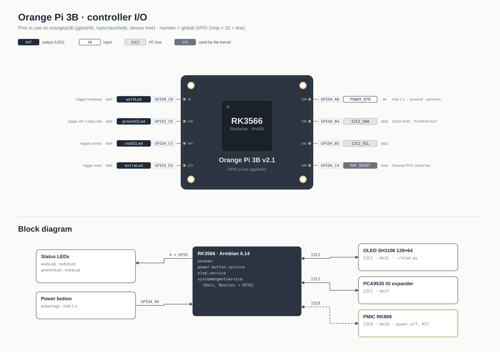

# Orange Pi 3B: power button, OLED, power-off

Board: Orange Pi 3B v2.1 (RK3566, PMIC RK809), Armbian, kernel 6.14 edge.



*GPIO lines in use (from `gpioinfo`, `/sys/class/leds` and the device tree). Hover the picture → **Edit diagram**.*

## GPIO power button

A button on **gpiochip4 line 0** (GPIO4_A0, global number 128): pressed = `1`, released = `0`.
Holding it for 1 s runs `systemctl poweroff`.

Files:
[power-button.py](../docs/power-button.py)
[power-button.service](../docs/power-button.service)
[power-button.default](../docs/power-button.default)
[install-power-button.sh](../docs/install-power-button.sh)

| What | Where |
|---|---|
| daemon | `/usr/local/sbin/power-button` (python3-gpiod 1.6, events on both edges, internal pull-down) |
| unit | `/etc/systemd/system/power-button.service` (root) |
| settings | `/etc/default/power-button`: `PB_CHIP`, `PB_LINE`, `PB_HOLD`, `PB_ACTION` |

Install / update (put the four files in one folder and rename `install-power-button.sh` → `install.sh` or run it from there):

```bash
sudo sh install.sh
journalctl -u power-button -f       # watch presses
```

> [!NOTE]
> The daemon arms only after it has seen the line LOW, so a stuck or miswired button cannot cause a shutdown loop at boot.
> While the service runs the line is busy: the panel's **Devices → GPIO** tab shows it with consumer `power-button`.

A GPIO button can only switch the board **off** — GPIOs are unpowered when it is off. To switch it on as well
the button has to go to the PMIC `PWRON` pin (the kernel already has `rk805 pwrkey`, systemd-logind handles it).

## OLED shows the shutdown

`~/oled.py` (`oled.service`, SH1106 128×64 on I²C bus 2) catches `SIGTERM`. If systemd is going down
(`systemctl list-jobs` has `poweroff.target` / `reboot.target`) it draws **SHUTTING DOWN** or **REBOOTING**
and exits without clearing the display; on a normal service stop the display is cleared.

## Power-off turns into a restart

The `poweroff` itself works (the PMIC driver and `system-power-controller` in the dtb are fine), but the
board comes back about 4 s later. The PMIC power-on source register says why it switched on:

[pmic-source.py](../docs/pmic-source.py)

```bash
python3 pmic-source.py
# ON_SOURCE  0xF5 = 0x40  -> plug-in (VCC rising)
```

`0x40` after a power-off points at the supply: the PMIC sees the input voltage rise again and powers on.
Typical cause: a USB-C PD charger that drops and restores 5 V when the load disappears.

- [ ] Try a plain 5 V / 3 A supply without PD
- [ ] Compare `pmic-source.py` after `sudo reboot`, after re-plugging the cable and after `poweroff`

> [!WARNING]
> The bit meaning is from the RK817/RK809 register map and was not checked against the datasheet.
