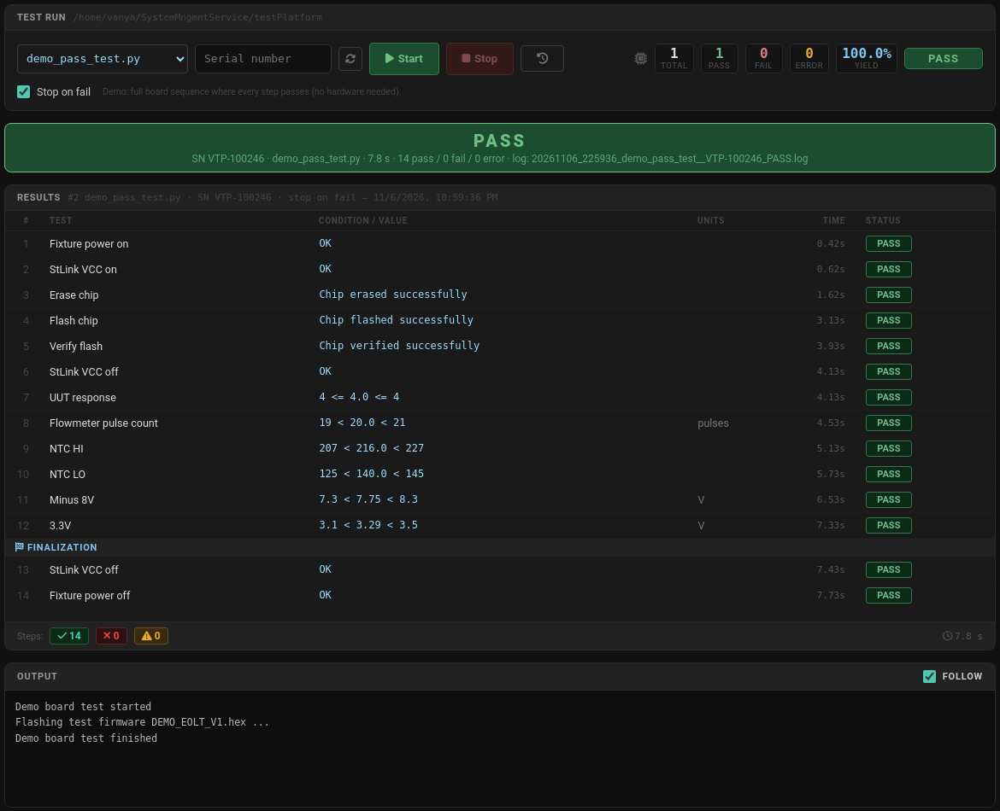
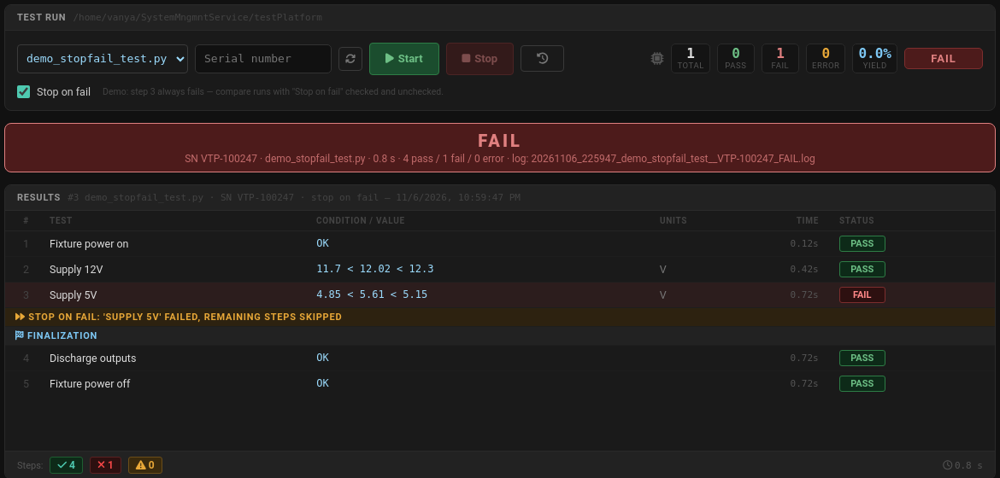
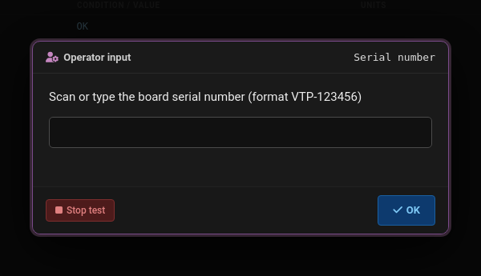
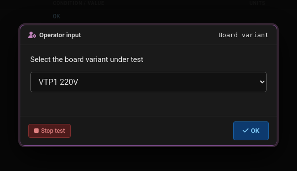
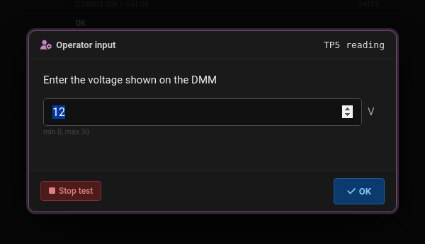
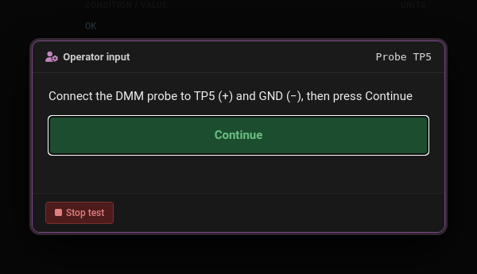
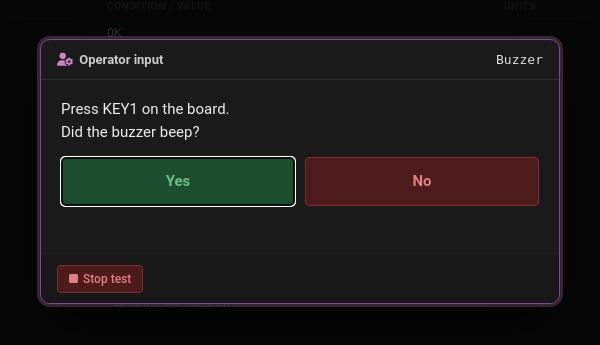
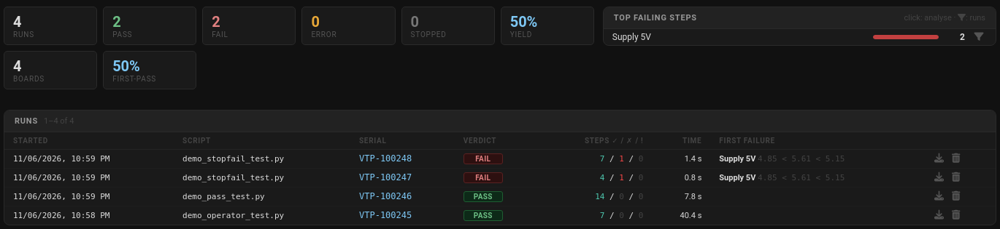
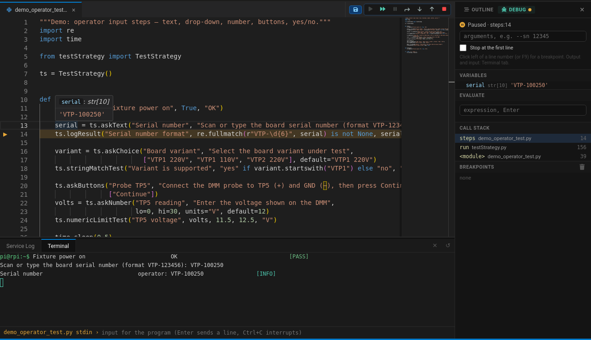

# Test platform

Hardware test sequences (`*_test.py`) are written in Python with the `TestStrategy` class from
`testPlatform/testStrategy.py`. The same script runs:

- on the **Tests** page (**Tests → Run**) — results table, verdict, operator dialogs, a log file per run;
- in an **SSH console** — `python3 my_board_test.py --sn 123` prints the same steps as a text table;
- in the **Code editor** — ▶ Run / 🐞 Debug with breakpoints (see [Debugging](#debugging-in-the-code-editor)).



## Script template

Copy this into `testPlatform/<name>_test.py` (the name must end with `_test.py`, the first docstring line is the
description shown on the Tests page):

```python
"""My board: power, firmware, measurements."""
import time

from testStrategy import TestStrategy

ts = TestStrategy()


def steps():
    ts.logResult("Fixture power on", True, "OK")
    time.sleep(0.2)
    ts.numericLimitTest("Supply 12V", 12.02, 11.7, 12.3, "V")


def finalize():
    ts.logResult("Fixture power off", True, "OK")


if __name__ == "__main__":
    ts.run(steps, finalize)
```

> [!IMPORTANT]
> Put every step into `steps()` and the safe-state code (relays off, power off, discharge) into `finalize()`.
> `ts.run(steps, finalize)` always calls `finalize` — after a pass, a fail with *Stop on fail*, an exception
> and when the operator presses **Stop**.

## Result statuses

| Status | Meaning | Verdict |
|---|---|---|
| `PASS` | the check passed | — |
| `FAIL` | value out of limits / not equal | **FAIL** |
| `ERROR` | the step could not be measured (bad value, timeout, exception) | **ERROR** (wins over FAIL) |
| `INFO` | operator answer, logged for the record | not counted |
| `SECTION` | separator row (`ts.section()`, *Finalization*) | not counted |

The run verdict is `ERROR` if any step is `ERROR`, else `FAIL` if any step is `FAIL`, else `PASS`.
A script that exits with a non-zero code or reports no results gets an extra `Script exit — ERROR` step;
a run stopped by the operator is `STOPPED`.

> [!TIP]
> In the code editor's **?** window every example line has *Insert* / *Copy*. `import …` lines of an example
> go to the imports at the top of the file (only if the file does not import it yet), the rest at the cursor.

## Test operators

Every operator logs one result row and **returns `True` / `False`**, so a script can react to a result:

```python
if not ts.numericLimitTest("Supply 5V", volts, 4.85, 5.15, "V"):
    ts.logError("Load test", "skipped: no 5V")
```

### numericLimitTest — exclusive limits

`numericLimitTest(name, value, lo, hi, units="")` — PASS when `lo < value < hi`.

```python
ts.numericLimitTest("Supply 12V", 12.02, 11.7, 12.3, "V")
ts.numericLimitTest("Idle current", 41.5, 35, 50, "mA")
ts.numericLimitTest("Flowmeter pulse count", pulses, 19, 21, "pulses")
```

Condition column: `11.7 < 12.02 < 12.3`. A value that is not a number (`None`, `"timeout"`) gives **ERROR**
`ERR: cannot convert 'timeout'` instead of an exception.

### numericLimitTestInclusive — inclusive limits

`numericLimitTestInclusive(name, value, lo, hi, units="")` — PASS when `lo <= value <= hi`.
Use it for exact values and integer ranges:

```python
ts.numericLimitTestInclusive("UUT response", 4, 4, 4, "")
ts.numericLimitTestInclusive("NTC value", adc_raw, 209, 223, "")
```

Condition column: `209 <= 215.0 <= 223`.

### stringMatchTest — exact text

`stringMatchTest(name, value, expected)` — PASS when the strings are equal (case-sensitive, no trimming).

```python
ts.stringMatchTest("FW version response", reply.strip(), "4")
ts.stringMatchTest("LED1 is green", led, "Green")
```

Condition column: `'4' == '4'`.

### booleanTest — true / false

`booleanTest(name, value, expected=True)` — PASS when `value == expected`.

```python
ts.booleanTest("Key1 state off", key1_pressed, False)
ts.booleanTest("Buzzer beeps on KEY1", beep, True)
```

### logResult — a step without limits

`logResult(name, passed, info="")` — logs PASS / FAIL as given; `info` goes to the condition column.
For actions (relays, flashing) and checks done by your own code:

```python
ts.logResult("Fixture power on", True, "OK")
ok = flash_firmware("DEMO_EOLT_V1.hex")          # your own function
ts.logResult("Flash chip", ok, "Chip flashed successfully" if ok else "stm8flash failed")
```

### logError — mark a step as ERROR

`logError(name, message="")` — the step could not be done (no answer, exception):

```python
try:
    count = read_counter(timeout=2)              # your own function
except TimeoutError:
    ts.logError("FM counter", "timeout reading counter")
```

### section — separator row

`section(title)` — a header row between groups of steps (not counted):

```python
ts.section("Measurements")
```

## Sequence, finalization, Stop on fail

`ts.run(steps, finalize=None)` runs `steps()`, then `finalize()`. It returns `True` if all steps ran.

With **Stop on fail** (checkbox on the Tests page, `--stop-on-fail` in a console) the first FAIL / ERROR inside
`steps()` skips the remaining steps and goes straight to finalization. Steps in `finalize()` are never
interrupted.



```python
def steps():
    ts.numericLimitTest("Supply 12V", 12.02, 11.7, 12.3, "V")
    ts.numericLimitTest("Supply 5V", 5.61, 4.85, 5.15, "V")      # FAIL -> next lines skipped
    ts.numericLimitTest("Supply 3.3V", 3.30, 3.2, 3.4, "V")


def finalize():
    ts.logResult("Discharge outputs", True, "OK")
    ts.logResult("Fixture power off", True, "OK")
```

`ts.stopOnFail` tells the script whether the option is on (e.g. to skip a slow optional step).

## Watch loop: emergency stop and other background checks

`testWatch.py` runs checks in the background (an asyncio loop in its own thread) **the whole time the steps
run**. A check is a function (or `async def`) that **raises an exception to abort the test**: the steps are
interrupted at once — even inside `time.sleep()`, a serial read or an operator dialog — an ERROR row with the
check's name is logged, the remaining steps are skipped and `finalize()` runs. The watch stops before
`finalize()`, so the finalization is never interrupted.

```python
from testStrategy import TestStrategy
from testWatch import TestWatch, EmergencyStop

ts = TestStrategy()
watch = TestWatch(interval=0.05)


def estop():
    if estop_line.get_value() == 1:             # your input: gpiod line, PSU EXT_IO input, ...
        raise EmergencyStop("button pressed")


watch.add("Emergency stop", estop)
watch.require("Fixture lid closed", lambda: psu.ioIn(2, 0) == 0, "lid opened")   # False = abort

if __name__ == "__main__":
    ts.run(steps, finalize, watch=watch)
```

| Call | Meaning |
|---|---|
| `TestWatch(interval=0.1)` | default polling interval of the checks, s |
| `watch.add(name, check, interval=None)` | `check()` raises → abort; `name` is the ERROR row |
| `watch.require(name, condition, message, interval=None)` | abort when `condition()` returns a false value |
| `ts.run(steps, finalize, watch=watch)` | starts the watch with the steps, stops it before `finalize` |
| `with watch: …` | without `ts.run()`: an abort raises `AbortTest` inside the block |
| `watch.error` | the abort (name, message) or `None` |
| `file_flag(path, message)` | a "button" for benches without hardware: abort while the file exists |
| `raise AbortTest(name, message)` | abort the sequence from a step yourself (`from testStrategy import AbortTest`) |

The run verdict is **ERROR**. The **Stop** button of the Tests page and Ctrl+C still work as before.

`demo_pass_test.py` watches the file `testPlatform/ESTOP` — `touch testPlatform/ESTOP` while it runs to
"press" the button, `rm` it to release. `demo_estop_test.py` presses a simulated button after 2 s:

```text
Fixture power on                          OK                                  [PASS]
Supply 12V                                11.7 < 12.02 < 12.3       V         [PASS]
Burn-in 10 s ...
Emergency stop                            button pressed                      [ERROR]
-------------------- Aborted: Emergency stop, remaining steps skipped --------------------
-------------------- Finalization --------------------
Fixture power off                         OK                                  [PASS]
```

> [!TIP]
> Keep checks short and non-blocking (read an input, compare): they run every `interval` seconds. A check
> that talks to an instrument should use its own timeout.

## Parameters: serial number and options

| Parameter | Where it comes from | In the script |
|---|---|---|
| Serial number | *Serial number* field on the Tests page, `--sn 12345` in a console | `ts.serial` (`''` if not given) |
| Stop on fail | checkbox on the Tests page, `--stop-on-fail` in a console | `ts.stopOnFail` |
| Your own options | console / editor arguments | `sys.argv` |

```python
ts.logResult("Serial number", bool(ts.serial), ts.serial or "not given")
```

The serial number (letters, digits, `-`, `_`, `.`) is part of the log file name and the log header.
In the code editor put the arguments into **Debug → arguments**, e.g. `--sn VTP-100245`.

## Instruments

### Power supply — psu.py

The 2-channel SCPI power supply (web page `http://192.168.1.91/`, command reference under *SCPI Commands*).
The driver sends raw SCPI over TCP port 8080, one connection per command; an `ERROR: …` answer or no answer
raises `PsuError`. Channels are `1` and `2`, values in V / A / W.

```python
from psu import PSU

psu = PSU("192.168.1.91")


def steps():
    psu.setup(1, 12.0, 0.5)                     # 12 V, 0.5 A limit, output on
    v = psu.waitVoltage(1, 12.0, tolerance=0.1, timeout=3)
    ts.numericLimitTest("Supply 12V", v, 11.7, 12.3, "V")
    ts.numericLimitTest("Idle current", psu.getCurrent(1) * 1000, 35, 50, "mA")


def finalize():
    psu.allOff()                                # both outputs off, protections cleared
```

All functions — outputs, measurements, protection, the onboard DMM (AIN0-3), the EXT1 / EXT2 modules
(INA228 / ADS1115), the EXT_IO relay / input cards, the external I²C bus, calibration, versions and the event
log — with copyable examples: **[Power supply PSU](psu.md)**.

Check from a console (read-only, nothing is switched): `python3 psu.py 192.168.1.91`.

### Multimeter — dmm.py

The FS9922 multimeter on a USB serial port: `FS9922DMM(port)`, `getVolt()`, `getAmp()`, `getResistance()`, … —
see `testPlatform/dmm.py`.

## Operator dialogs

The `ask*` methods stop the script until the operator answers. On the Tests page they open a dialog, in a
console they ask with `input()`. Every answer is logged as an **INFO** row (`operator: 12.1`) and returned, so
check it with a test operator afterwards.

> [!WARNING]
> Never call `input()` in a test script: the Tests page sends only one Enter and then closes stdin.
> Always use the `ask*` methods.

### askText — free text

`askText(name, message, default="")` → `str`. Empty answers are not accepted.

```python
import re

serial = ts.askText("Serial number", "Scan or type the board serial number (format VTP-123456)")
ts.logResult("Serial number format", re.fullmatch(r"VTP-\d{6}", serial) is not None, serial)
```



### askChoice — drop-down list

`askChoice(name, message, options, default=None)` → the selected option.

```python
variant = ts.askChoice("Board variant", "Select the board variant under test",
                       ["VTP1 220V", "VTP1 110V", "VTP2 220V"], default="VTP1 220V")
```



### askNumber — number with limits

`askNumber(name, message, lo=None, hi=None, units="", default=None)` → `float`. The dialog refuses values
outside `lo … hi`.

```python
volts = ts.askNumber("TP5 reading", "Enter the voltage shown on the DMM", lo=0, hi=30, units="V", default=12)
ts.numericLimitTest("TP5 voltage", volts, 11.5, 12.5, "V")
```



### askButtons — one button per answer

`askButtons(name, message, buttons=("OK",))` → the label of the pressed button. With one button it is a
"do this, then continue" instruction.

```python
ts.askButtons("Probe TP5", "Connect the DMM probe to TP5 (+) and GND (−), then press Continue", ["Continue"])
led = ts.askButtons("LED1 colour", "What colour is LED1?", ["Green", "Red", "Off"])
ts.stringMatchTest("LED1 is green", led, "Green")
```



### askYesNo — yes / no question

`askYesNo(name, message)` → `bool` (`True` for *Yes*). `\n` in the message starts a new line.

```python
beep = ts.askYesNo("Buzzer", "Press KEY1 on the board.\nDid the buzzer beep?")
ts.booleanTest("Buzzer beeps on KEY1", beep, True)
```



## Console output (SSH)

Without the web runner every result is a row of a text table (colours on a terminal):

```text
Fixture power on                          OK                                  [PASS]
Supply 12V                                11.7 < 12.02 < 12.3       V         [PASS]
Supply 5V                                 4.85 < 5.61 < 5.15        V         [FAIL]
-------------------- Stop on fail: 'Supply 5V' failed, remaining steps skipped --------------------
-------------------- Finalization --------------------
Discharge outputs                         OK                                  [PASS]
Fixture power off                         OK                                  [PASS]
```

```bash
cd ~/SystemMngmntService/testPlatform
python3 demo_stopfail_test.py --stop-on-fail --sn VTP-100247
python3 testStrategy.py              # self-test: one example of every operator
```

## Logs

Every run on the Tests page writes `testLogs/<date>_<time>_<script>[__<serial>]_<VERDICT>.log`, e.g.
`20261106_225947_demo_stopfail_test__VTP-100247_FAIL.log`:

```text
Script:   demo_stopfail_test.py
Serial:   VTP-100247
Stop on fail: yes
Host:     orangepi3b
Started:  2026-11-06 22:59:47
----------------------------------------------------------------------------------------------------
[    0.12s] PASS   Fixture power on                         OK
[    0.42s] PASS   Supply 12V                               11.7 < 12.02 < 12.3          V
[    0.72s] FAIL   Supply 5V                                4.85 < 5.61 < 5.15           V
             ---- Stop on fail: 'Supply 5V' failed, remaining steps skipped ----
             ---- Finalization ----
[    0.72s] PASS   Discharge outputs                        OK
[    0.72s] PASS   Fixture power off                        OK
----------------------------------------------------------------------------------------------------
Finished: 2026-11-06 22:59:48  (0.8 s, exit code 0)
Results:  7 total, 4 pass, 1 fail, 0 error
VERDICT:  FAIL
```

Lines printed by the script (`print()`) appear in the log after `|`. **Tests → Logs** filters the runs by script,
verdict, serial number and date, shows yield / first-pass yield and the steps that fail most often, and exports CSV.



## Debugging in the code editor

Open the script in **Code**, click left of a line number (or `F9`) for a breakpoint and press 🐞 (`F5`).
The script runs exactly as in a console (operator questions are asked in the **Terminal** tab), so you can step
through a test without the Tests page:

| Key | Action |
|---|---|
| `F5` | Debug / Continue |
| `Ctrl+F5` | Run without the debugger |
| `F10` / `F11` / `Shift+F11` | Step over / into / out |
| `F6` / `Shift+F5` | Pause / Stop (`finalize` still runs) |
| `F7` (↶) | run the previous line again: the execution point goes back one line, `F10` runs it once more |
| right-click → *Set next line here* | continue from any line of the paused function |

↶ and *Set next line here* only move the execution point (like pdb `jump`): values, printed output and the
hardware state are **not** undone, and Python refuses jumps into the body of a loop or a `try` block.
Hover a variable to see its value; **Debug** in the side panel shows the variables, the call stack and an
*Evaluate* box. Arguments such as `--sn VTP-100250` go into the *arguments* field.



> [!NOTE]
> A script started from the editor and a run on the Tests page exclude each other — the fixture is used by one
> of them at a time.

## Demo scripts

They need no hardware — use them to try the page and as examples:

| Script | Shows |
|---|---|
| `demo_pass_test.py` | a full board sequence where every step passes |
| `demo_stopfail_test.py` | step 3 always fails — compare *Stop on fail* on / off |
| `demo_operator_test.py` | every operator dialog |
| `demo_random_test.py` | random spread with tight limits — FAIL / ERROR, statistics in the log viewer |
| `demo_crash_test.py` | an exception in a step: ERROR + finalization |
| `demo_long_test.py` | a long burn-in (~60 s) — press Stop, finalization still runs |
| `demo_estop_test.py` | the emergency stop watch aborts a burn-in after 2 s (verdict ERROR, finalization runs) |
| `demo_serial_test.py` | the serial number from the Tests page (`--sn`); valid: `test` or `VTP-123456` |

## Checklist for a new test

- [ ] file name `<name>_test.py`, docstring = description
- [ ] all hardware access inside `steps()`, safe state in `finalize()` (e.g. `psu.allOff()`)
- [ ] emergency stop / fixture interlocks as `TestWatch` checks, passed to `ts.run(..., watch=watch)`
- [ ] every measurement goes through a test operator (limits + units)
- [ ] operator input only with `ask*`, never `input()`
- [ ] exceptions of a step are caught and logged with `logError` when the sequence can continue
- [ ] tried in a console (`python3 x_test.py --sn TEST`) and on the Tests page
